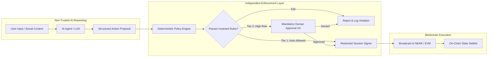

# VEILX AGENT — SECURITY ARCHITECTURE & POLICY-DRIVEN ENFORCEMENT RESEARCH

> **Audit Date:** November 7, 2026  
> **Topic:** AI Agent Security Architecture, Delegated Authority, Policy Engines, and Cryptographic Safeguards  
> **Repository Context:** `C:\Users\HomePC\Downloads\VeilX-Agent`

---

## 1. The Core Architectural Axiom

```
THE AI MAY PROPOSE AND REASON ABOUT ACTIONS,
BUT AN INDEPENDENT POLICY & AUTHORIZATION ENGINE
MUST DECIDE WHETHER THOSE ACTIONS ARE PERMITTED.
```

An LLM is a probabilistic pattern completion engine. It is inherently susceptible to prompt injection, semantic ambiguity, jailbreaking, hallucination, and social engineering. **Under no circumstances should an LLM's internal system prompt or conversational reasoning be treated as a security boundary.**

### Separation of Duties Matrix



| Lifecycle Phase | Component Responsible | Trust Level | Description |
| :--- | :--- | :--- | :--- |
| **1. Intent Interpretation** | AI Agent (LLM) | **Untrusted** | Parses conversational text, social context, and market data into a structured proposal. |
| **2. Policy Evaluation** | Policy Engine (Code/Contract) | **Authoritative** | Validates math, spending caps, allowlists, volatility limits, and rate-limits deterministically. |
| **3. User Authorization** | UI / Human-in-the-Loop | **Authoritative** | User signs explicit, cryptographic approval if proposal exceeds autonomous threshold. |
| **4. Transaction Signing** | Scoped Session Keypair | **Restricted** | Key is technically incapable of signing actions outside its contract-enforced permissions. |
| **5. Execution** | NEAR RPC / Defuse Solvers | **Verifiable** | Transactions broadcasted to network; non-reversible once finalized. |
| **6. Audit & Recovery** | Immutable Event Log | **Tamper-Evident** | Every action, failure, and policy override is recorded with cryptographic proofs. |

---

## 2. 25 Core Agent Security Vectors & Safeguards

### 1. User Identity & Ownership
- **Principle:** The master user account is owned by the user via their external wallet or passkey/X OAuth anchor (`{handle}-main.veilx-agent.testnet`).
- **Safeguard:** Master keys never leave the user's custody. The agent only receives ephemeral, revocable session keys.

### 2. Agent Identity
- **Principle:** Distinct on-chain sub-account (`{handle}-agent.veilx-agent.testnet`).
- **Safeguard:** The agent has its own explicit public key and address, ensuring every action is attributable to the agent rather than the human.

### 3. Delegated Permissions (NEP-366)
- **Principle:** Function-call access keys restricted to specific smart-contract methods (e.g. `send_tip`, `execute_intent`, `swap`).
- **Safeguard:** The key cannot perform account deletion, master key addition, or full-balance withdrawals.

### 4. Scoped Authority
- **Principle:** Compartmentalization between APay and Trading.
- **Safeguard:** An agent key authorized for social tipping cannot execute equity liquidations or change portfolio risk policies.

### 5. Session Permissions & 6. Permission Expiration
- **Principle:** Time-bound delegation.
- **Safeguard:** Session keys expire automatically after a predefined duration (e.g. 24 hours, 7 days). Re-authorization requires explicit user interaction.

### 7. Spending Limits & 8. Trading Limits
- **Principle:** Multi-dimensional financial ceilings.
- **Safeguard:**
  - Per-transaction limit (e.g. max $25 per tip).
  - Rolling 24-hour limit (e.g. max $100 per day).
  - Cumulative session cap (e.g. $500 total).

### 9. Asset Allowlists
- **Principle:** Strict whitelist of tradeable tokens and equities.
- **Safeguard:** The agent is physically blocked by the policy engine from interacting with unknown contract addresses, meme tokens, or unverified pools.

### 10. Transaction Restrictions
- **Principle:** Destination controls.
- **Safeguard:** Direct transfers can only route to registered `.near` accounts, validated checksum `0x` EVM addresses, or verified X handles.

### 11. Human Approval Requirements (Risk-Tiered Flow)
- **Tier 0 (Instant):** Tips under $5 to previously tipped handles.
- **Tier 1 (Instant with Notification):** Swaps under $50 meeting all rebalance rules.
- **Tier 2 (Explicit Approval):** Any trade over $100, any new asset, or any transfer to a first-time recipient.

### 12. Emergency Pause & 13. Permission Revocation
- **Principle:** Instant global halt.
- **Safeguard:** One-click "PAUSE ALL" button in header immediately deletes the local session key and calls `delete_key` on NEAR, neutralizing the agent in <2 seconds.

### 14. Agent Recovery
- **Principle:** Deterministic fail-safe state recovery.
- **Safeguard:** If agent state crashes or desynchronizes, it re-queries on-chain account state and rebuilds its balance ledger from zero trust.

### 15. Action History & Auditability
- **Principle:** Tamper-evident logging.
- **Safeguard:** Every action generates an HMAC selective disclosure receipt stored in MongoDB with the corresponding on-chain transaction hash.

### 16. Suspicious Activity Detection
- **Principle:** Anomaly heuristic triggers.
- **Safeguard:** Rapid repeated transfers (>3 in 60s), sudden volume spikes, or repeated failed orders trigger automatic agent freeze.

### 17. Prompt Injection Resistance (Direct & Social)
- **Principle:** Sanitization & strict boundary enforcement.
- **Safeguard:** Incoming prompt text from X tweets, DMs, or invoice memos is treated as **untrusted data strings**, never executed as system prompt instructions.

### 18. Malicious External Data (Oracles & APIs)
- **Principle:** Price deviation & staleness breakers.
- **Safeguard:** If price feeds from Defuse or Pyth differ by >3% or are >60s old, all automated trades are refused.

### 19. Agent Memory Manipulation
- **Principle:** Stateless authorization.
- **Safeguard:** The agent's conversational context memory is **never** used to verify whether a spending cap has been reached. Caps are read directly from on-chain state or cryptographically signed local ledgers.

### 20. Unauthorized Policy Changes
- **Principle:** Immutable permission boundary.
- **Safeguard:** The agent has zero methods to edit its own `riskPolicy` or `spendingLimitUsd`. Policy updates require master wallet authorization.

### 21. Conflicting Instructions
- **Principle:** Priority resolution hierarchy.
- **Safeguard:** Platform security rules > User policy settings > User conversational prompt > Agent recommendation.

### 22. Repeated or Duplicated Actions
- **Principle:** Idempotency keys.
- **Safeguard:** Every intent or tip proposal includes a unique nonce/UUID. If submitted twice, the policy engine drops the duplicate.

### 23. Agent Behavior After Errors
- **Principle:** Fail-closed default.
- **Safeguard:** On RPC failure or timeout, the agent ceases execution, releases locked balances, and alerts the user rather than blindly retrying.

### 24. Unavailable Market / Balance Data
- **Principle:** Zero-assumption halting.
- **Safeguard:** If balance or price cannot be verified, execution is impossible.

### 25. Hardware TEE Enclave Attestation
- **Principle:** Verifiable confidential execution.
- **Safeguard:** Critical financial parsing executes inside NEAR AI Cloud TEE enclaves, generating cryptographic remote attestations verifying model weights and prompt integrity.
