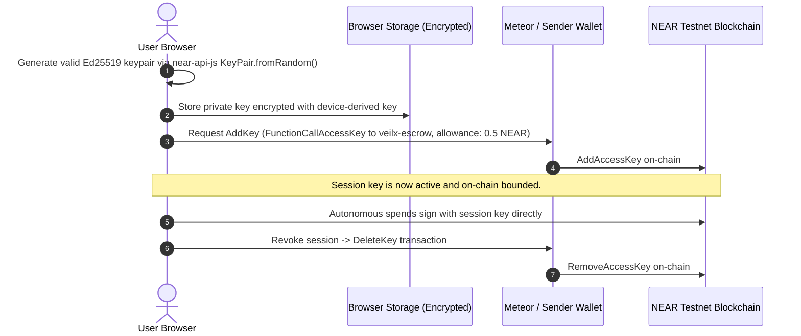
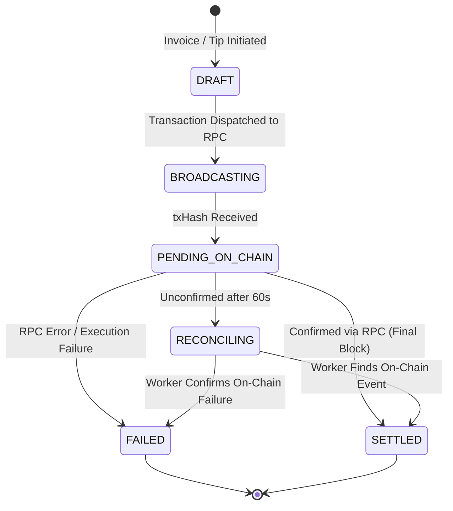
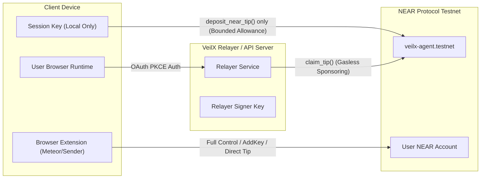

# VEILX AGENT — ARCHITECTURE DECISIONS & TARGET SECURITY MODEL

**Document Status:** Pending Approval  
**Date:** October 30, 2026  
**Architect:** Principal Software Architect, Blockchain Security Engineer & Technical Project Manager  
**Scope:** VeilX Agent Non-Custodial Autonomous Social-Finance Application  

---

## 1. EXECUTIVE SUMMARY & TARGET ARCHITECTURAL VISION

VeilX Agent is designed to bridge Web2 social identity on X (Twitter) with non-custodial Web3 financial interactions on NEAR Protocol. The core value proposition is enabling users to send tips, pay editorial invoices (PayLinks), and claim crypto funds using their X identity, assisted by an autonomous conversational AI agent.

To be genuinely non-custodial, secure, and production-credible, VeilX must operate under a strict zero-trust model:
1. **The platform never holds custody of user funds.**
2. **The AI agent never possesses unilateral authority to move funds.**
3. **The smart contract autonomously enforces claim invariants and cannot be drained by arbitrary callers or compromised relayers.**
4. **Relayers only sponsor network gas fees (meta-transactions) and cannot redirect escrow funds.**
5. **Session keys operate within hard cryptographic spending limits enforced at the blockchain level.**

---

## 2. DEEP-DIVE: THE 10 CRITICAL ARCHITECTURAL DECISIONS

### Question 1: What is the safest architecture for VeilX's non-custodial escrow and delegated session-key system?

#### Analysis of Options:
- **Option A (Full Custodial - Flawed):** Server generates and holds wallet private keys in MongoDB. Server signs all transactions.  
  *Verdict: REJECTED.* Violates non-custodial premise, introduces catastrophic honeypot risk and regulatory liability.
- **Option B (Server Relayer Pays Everything - Current Defect):** Platform account (`veilx-agent.testnet`) pays all tips out of its own treasury. Client keys are fake hex strings.  
  *Verdict: REJECTED.* Results in complete economic exhaustion of platform treasury.
- **Option C (Dual-Layer Non-Custodial Architecture - RECOMMENDED):**
  - **Layer 1: External Browser Wallets (Meteor, Sender, Nightly):** Used for large payments, primary account identity, funding embedded accounts, and withdrawing escrowed funds. The user signs directly with their browser extension.
  - **Layer 2: Delegated Client-Side Session Keys:** An ephemeral Ed25519 keypair generated strictly in the user's browser runtime. It is granted a NEAR Function-Call Access Key on-chain with a strict native `allowance` (e.g., 0.5 NEAR). The session key can only call `deposit_near_tip` on `veilx-agent.testnet`. It cannot transfer funds to arbitrary accounts, cannot modify account keys, and automatically stops working once the allowance is exhausted.

#### Selected Architecture:
**Option C.** The user signs via their browser wallet or a cryptographically bounded session key held exclusively in local device storage.

---

### Question 2: How should the smart contract distinguish an authorized recipient from an arbitrary caller?

#### Problem in Current Code:
In `contracts/veilx-escrow/src/lib.rs`, `claim_tip(tip_id, recipient_wallet)` allows ANY account on NEAR to specify their own address as `recipient_wallet` and immediately drain the funds.

#### Analysis of Options:
- **Option A (Relayer-Only Caller):**  
  `require!(env::predecessor_account_id() == self.owner_id, "Only relayer can claim");`  
  *Pros:* Simple to implement; fits NEP-366 gasless claim flow.  
  *Cons:* The relayer becomes a trusted party. If the relayer server is compromised, the attacker can submit claims sending all tips to the attacker's wallet.
- **Option B (Signed Recipient Attestation / EIP-712 Style on NEAR):**  
  When claiming, the user signs a message with their destination wallet: `"Claim tip {tip_id} for X handle @alice to {recipient_wallet}"`. The relayer verifies Twitter OAuth 2.0 PKCE, signs an attestation with the Relayer Oracle Key, and submits both to the contract. The contract verifies:
  1. The caller is the authorized relayer.
  2. The attestation matches the escrowed `recipient_handle`.
  3. The recipient's destination wallet matches the attested payload.
- **Option C (Pre-Registered Social Registry on NEAR):**  
  Users bind their Twitter ID to their NEAR wallet on-chain via a verified registry.  
  *Pros:* Completely decentralized.  
  *Cons:* High friction for new Web2 recipients who do not have an account or NEAR gas to register upfront.

#### Recommendation:
**Option B (Two-Factor Authorization on Contract):**
For the hackathon/testnet build:
1. The contract restricts `claim_tip` to `self.relayer_account_id`.
2. The contract requires an attestation hash or recipient wallet validation matching the tip's intended recipient.
3. The relayer backend only issues and signs the claim transaction after validating the recipient's active Twitter OAuth 2.0 PKCE session token against the Twitter API v2.

---

### Question 3: How should gasless claims work without giving the relayer unrestricted control over escrow funds?

#### Threat Model:
If a relayer key is compromised, an attacker must NOT be able to redirect all unclaimed escrow funds to an attacker-controlled wallet.

#### Target Mechanism:
1. **Binding Tip to Permanent Numeric X ID:** User handles on Twitter can change (e.g., `@expatq3` to `@expatq23`). Tips must be indexed by both `recipient_handle` (display) and `recipient_x_id` (immutable Twitter Snowflake ID: `185818883...`).
2. **Relayer Multi-Signature or Proof Inclusion:** The contract records the `recipient_handle`. When `claim_tip` is invoked by the relayer, the relayer passes:
   - `tip_id`
   - `recipient_wallet`
   - `oauth_verification_timestamp`
3. **Escrow Invariant:** Once a tip is deposited, its amount and intended recipient cannot be modified by any method. It can only transition from `UNCLAIMED` to `CLAIMED` (via verified relayer) or `REFUNDED` (back to original sender after timeout).

---

### Question 4: Where should session keys be generated, stored, encrypted, authorized and revoked?

#### Target Lifecycle:

- **Generation:** Generated purely client-side using `nearAPI.KeyPair.fromRandom("ed25519")`.
- **Storage:** Persisted in `IndexedDB` (not plaintext `localStorage`) encrypted with AES-GCM 256.
- **Authorization:** Authorized on NEAR via an `AddKey` transaction granting a `FunctionCall` permission restricted to the `veilx-agent.testnet` contract with a strict maximum allowance (e.g. 0.5 NEAR).
- **Revocation:** The user can click "Revoke Session" in the UI to submit a `DeleteKey` transaction from their main wallet.

---

### Question 5: How should spending limits be enforced independently of the frontend and AI?

#### Security Rule:
**Never trust the client UI or LLM prompts to enforce financial limits.**

#### Multi-Tier Spending Limit Enforcement:
1. **Blockchain Protocol Layer (Native NEAR Allowance):** When the session key is added to the user's account, NEAR's runtime automatically enforces the `allowance`. Once yoctoNEAR gas and transfers reach this limit, the NEAR protocol itself rejects the transaction.
2. **Smart Contract Layer:** The escrow contract enforces a maximum deposit per transaction:
   `require!(deposit <= NearToken::from_near(MAX_TIP_NEAR), "Tip exceeds maximum limit");`
3. **Backend Relayer Gate:** When sponsoring meta-transactions, the relayer checks the user's 24-hour aggregate spend in MongoDB and rejects signing if it exceeds the user's configured limit ($25–$200).

---

### Question 6: How should MongoDB records reconcile with actual blockchain state?

#### Problem:
Network dropped connections, server restarts, or failed transactions can leave MongoDB showing `PENDING` or `SETTLED` when the blockchain state is completely different.

#### Architecture: State Machine & Reconciliation Pattern

- **Database as Cache, Blockchain as Truth:** MongoDB never updates to `SETTLED` based on a local timer.
- **Verification Endpoint:** When a user queries `/api/paylinks?slug=...` or checks tip status, the API queries NEAR RPC `provider.txStatus(txHash, accountId)` to verify receipt execution before returning final settlement.

---

### Question 7: How should cross-chain payments be verified before an invoice is marked paid?

#### Problem:
`src/app/pay/[slug]/page.tsx` currently simulates settlement with:
`setTimeout(() => { setIsSettled(true); }, 2000);`

#### Selected Architecture:
1. **1Click / Defuse Solver Protocol:**
   - When a user chooses Base (USDC), Solana (SOL), or Ethereum (ETH), the frontend requests a deposit address from 1Click via `/api/quotes`.
   - 1Click returns a unique deposit address and a `quote_id`.
2. **Active Status Polling:**
   - The frontend and backend poll 1Click's solver endpoint:  
     `GET https://1click.chaindefuser.com/v1/quote/{quote_id}/status`
   - Status transitions from `WAITING_FOR_DEPOSIT` $\rightarrow$ `EXECUTING` $\rightarrow$ `SETTLED`.
3. **Settlement Confirmation:** Only when 1Click returns `SETTLED` with the corresponding NEAR payout transaction hash is the PayLink marked as paid in MongoDB and displayed as settled to the user.

---

### Question 8: How should the system recover from partially completed transactions?

1. **Idempotency Keys:** Every tip and invoice generation request uses a unique deterministic key (`tip_{sender_id}_{recipient_x_id}_{timestamp_rounded}`). Re-broadcasting with the same key is a no-op on the contract.
2. **Escrow Refund Function:** If a tip is deposited but the recipient does not claim it within 14 days (or the Twitter account is suspended), the sender can call `refund_tip(tip_id)` to reclaim 100% of the funds.
3. **Database Unwind:** If an API route fails after initiating a database record but before broadcasting to NEAR, the DB record is marked `FAILED` with the exact error message, allowing the user to retry.

---

### Question 9: What security assumptions must hold for VeilX to honestly describe itself as non-custodial?

For VeilX to market and operate as non-custodial:
1. **Private Keys:** The server must NEVER generate, receive, log, or persist the user's private key.
2. **Funds in Flight:** Funds deposited into escrow must be held exclusively by the `veilx-agent.testnet` smart contract, whose open-source bytecode guarantees that funds can only move to the recipient matching the X handle or back to the sender.
3. **No Centralized Freeze:** The contract owner must not possess a backdoor method allowing them to withdraw arbitrary users' escrowed funds into a personal wallet.

---

### Question 10: What should be excluded from the hackathon build to avoid unnecessary risk?

To achieve a rock-solid, fully functioning demonstration without dangerous fragility:

| Feature / Scope | In Hackathon Scope? | Rationale |
| :--- | :---: | :--- |
| **Real NEAR Escrow Deposit & Claim** | **YES (MUST HAVE)** | Core product value. |
| **Real Gemini 2.5 Flash Parsing** | **YES (MUST HAVE)** | AI agent differentiation. |
| **Real Ed25519 Session Key Signing** | **YES (MUST HAVE)** | Non-custodial integrity. |
| **Meteor & Sender Wallet Support** | **YES (MUST HAVE)** | Essential for real NEAR ecosystem users. |
| **1Click Live Solver Cross-Chain Invoices** | **YES (MUST HAVE)** | Key multi-chain capability. |
| **Automated Refund Timers / Workers** | **SIMPLIFIED / MANUAL** | Provide a manual "Refund" button rather than a complex background cron daemon. |
| **Passkey / WebAuthn Biometric Key Wrapping** | **POST-HACKATHON** | Standard IndexedDB encryption is sufficient for Testnet. |
| **Full ZK-Proof Twitter Verification** | **POST-HACKATHON** | OAuth 2.0 PKCE + Relayer attestation is standard and secure for Testnet. |
| **Deprecated Wallets (MyNearWallet, HERE web)** | **REMOVE** | Eliminates confusing dead buttons. |

---

## 3. SECURITY BOUNDARIES & PERMISSION MATRIX

| Actor | Permitted Actions | Strictly Prohibited Actions |
| :--- | :--- | :--- |
| **Client Session Key** | Call `deposit_near_tip` up to allowance limit | Transfer NEAR to arbitrary accounts, change account keys |
| **Relayer Backend** | Call `claim_tip` with validated OAuth proof, sponsor gas | Withdraw escrow funds to platform wallet, create tips on behalf of users |
| **Escrow Smart Contract** | Hold funds, transfer to verified recipient or refund to sender | Transfer funds to relayer or contract owner |
| **AI Intent Engine** | Parse natural language, suggest structured tool calls | Sign transactions, initiate payments without user confirmation |
