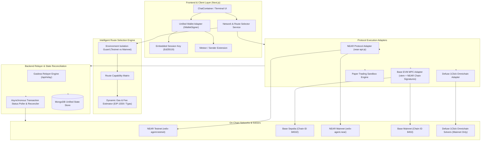
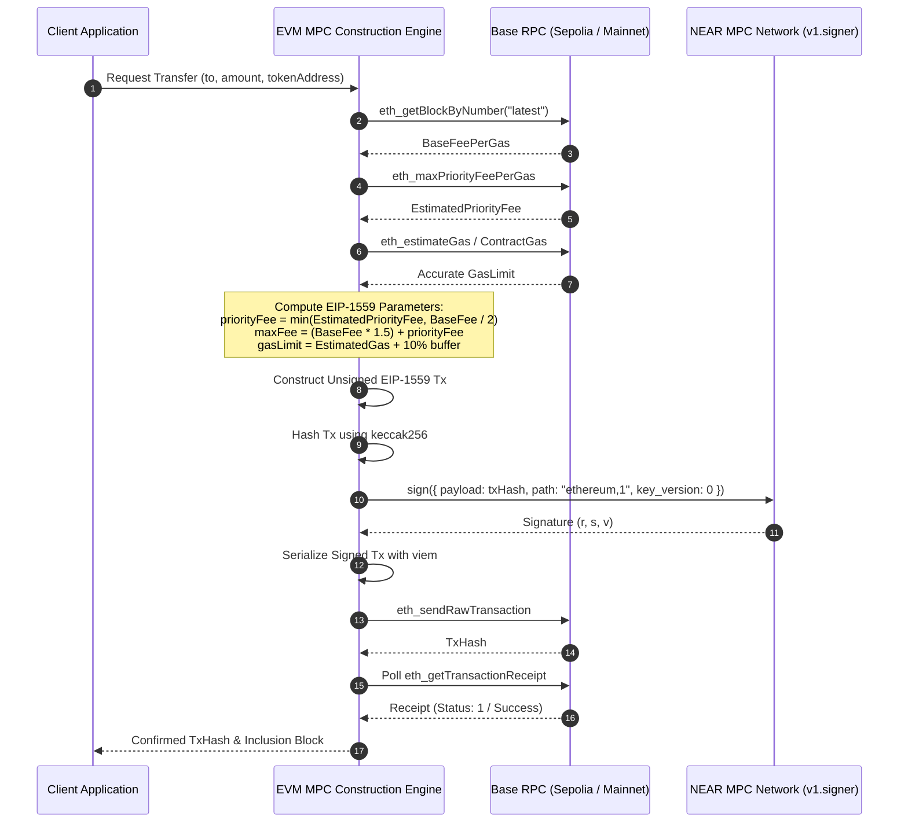

# VEILX AGENT — MULTI-ENVIRONMENT BLOCKCHAIN ARCHITECTURE PROPOSAL

**Target System:** VeilX Agent (`VeilX-Agent` / `XTip`)  
**Document Version:** 1.0.0  
**Status:** ARCHITECTURAL DESIGN SPECIFICATION  

---

## 1. ARCHITECTURAL OBJECTIVES & DESIGN PRINCIPLES

To eliminate the systemic failures uncovered in the audit, VeilX Agent requires an architectural overhaul anchored on five non-negotiable principles:

1. **Strict Environment Isolation:** Complete separation of Testnet and Mainnet execution paths, state, databases, credentials, and UI surfaces. A transaction initiated in Testnet must never touch Mainnet infrastructure, and vice versa.
2. **Deterministic Route Resolution:** No static assumptions or fabricated routes. If a route (e.g. 1Click Solver or Tokenized Stock) is not genuinely available in the active environment, the system must explicitly declare it unavailable.
3. **True Asynchronous Settlement Tracking:** A source deposit hash is never treated as destination settlement. Cross-chain intents must follow an explicit multi-step state machine with background verification.
4. **Unified Non-Custodial Signing Abstraction:** Decouple transaction construction from signing. Provide a unified `IWalletSigner` adapter that cleanly supports browser session keys, external browser extensions (Meteor, Sender), and NEAR MPC derived accounts without exposing private keys over HTTP.
5. **Fail-Closed Financial Safety:** Any discrepancy in fee calculation, gas estimation, contract parameters, or RPC verification must halt execution before broadcasting, protecting user capital and relayer gas.

---

## 2. SYSTEM ARCHITECTURE OVERVIEW



---

## 3. CORE ARCHITECTURAL MODULES

### 3.1 Centralized Network & Route Selector Service

The `RouteSelector` replaces ad-hoc network assumptions with a deterministic, real-time query pipeline:

```typescript
export interface RouteRequest {
  action: "social_tip" | "direct_transfer" | "cross_chain_swap" | "stock_trade" | "paylink_settle" | "withdraw";
  sourceAsset: string;
  sourceNetwork: "near_testnet" | "near_mainnet" | "base_sepolia" | "base_mainnet" | "solana" | "bitcoin";
  destinationAsset: string;
  destinationNetwork: string;
  amount: number;
  recipient: string;
  userEnvironment: "testnet" | "mainnet";
}

export interface RouteResolution {
  isAvailable: boolean;
  unavailableReason?: string;
  environment: "testnet" | "mainnet";
  executionProtocol: "near_native" | "near_escrow" | "base_mpc" | "defuse_1click" | "paper_trading";
  estimatedSourceFee: { amount: string; symbol: string; usdValue: number };
  estimatedDestinationFee?: { amount: string; symbol: string; usdValue: number };
  requiresEnvironmentSwitch: boolean;
  requiredTargetNetwork?: string;
  quoteExpiry?: number;
  warnings: string[];
}
```

#### Selection Invariant Rules:
1. **Rule 1 (Environment Strictness):** If `userEnvironment === "testnet"`, cross-chain routes through Defuse 1Click are marked `isAvailable: false` with `unavailableReason: "Defuse 1Click Omnichain Solvers are available exclusively on Mainnet"`.
2. **Rule 2 (No Silent Cross-Execution):** If an operation requires Mainnet, `requiresEnvironmentSwitch` is set to `true`. The UI presents a modal requiring explicit user confirmation before any network context change.
3. **Rule 3 (Equity Execution Segregation):** Stock trades on `TSLAon`, `NVDAon`, `AAPLon` resolve to `executionProtocol: "paper_trading"`. The UI renders a distinct "Paper Trading / Simulation" badge, preventing user confusion with real asset transactions.

---

### 3.2 Unified Non-Custodial Wallet Adapter (`IWalletSigner`)

Currently, `ChatContainer.tsx` directly reads `getStoredAgentSession()` from `localStorage` and instantiates a NEAR account using `near-api-js`. External wallets (Meteor, Sender) are ignored.

The new architecture introduces a unified interface:

```typescript
export interface IWalletSigner {
  readonly id: "embedded_session" | "meteor" | "sender" | "derived_evm_mpc";
  readonly networkId: "testnet" | "mainnet";
  
  getAccountId(): Promise<string>;
  getPublicKey(): Promise<string>;
  
  // NEAR native transfer
  transferNear(recipient: string, amountNear: string): Promise<{ txHash: string }>;
  
  // Smart contract call (e.g. escrow deposit)
  callContract(params: {
    contractId: string;
    methodName: string;
    args: Record<string, any>;
    attachedDepositNear?: string;
    gasTgas?: number;
  }): Promise<{ txHash: string }>;
  
  // EVM transaction signing via NEAR MPC
  signAndBroadcastEvm(params: {
    chainId: number;
    to: `0x${string}`;
    valueWei?: bigint;
    dataHex?: `0x${string}`;
    tokenContract?: `0x${string}`;
  }): Promise<{ txHash: `0x${string}` }>;
}
```

#### Security Guarantee:
* Private keys are **never** passed into API routes.
* Embedded session keys sign transactions locally within the user's browser.
* External wallets sign via their native extension approval prompts.
* EVM MPC transactions are signed on-chain by the NEAR MPC network (`v1.signer-prod.testnet` / `v1.signer`), coordinated without backend key custody.

---

### 3.3 Dynamic EVM EIP-1559 Construction & Signing Engine

To permanently resolve `ISSUE-CHAIN-01` and ensure reliable Base Sepolia and Base Mainnet execution:



---

### 3.4 Multi-Step Cross-Chain Settlement State Machine

To permanently eliminate `ISSUE-CHAIN-03` (fabrication of destination hashes), cross-chain intents strictly transition through an immutable state machine:

```mermaid
stateDiagram-v2
    [*] --> ORDER_CREATED: User confirms route & quote
    ORDER_CREATED --> DEPOSIT_SUBMITTED: Client broadcasts origin deposit
    DEPOSIT_SUBMITTED --> DEPOSIT_CONFIRMED: Source chain finality reached
    
    state "Asynchronous Solver Verification" as AsyncFill {
        DEPOSIT_CONFIRMED --> SOLVER_DETECTED: 1Click API acknowledges deposit
        SOLVER_DETECTED --> SOLVER_PROCESSING: Solver auction fills order
        SOLVER_PROCESSING --> DESTINATION_CONFIRMED: Real destination tx mined
    }

    DESTINATION_CONFIRMED --> SETTLED: Final destination receipt verified
    SOLVER_PROCESSING --> REFUNDED: Solver failed; refund tx confirmed
    ORDER_CREATED --> EXPIRED: Quote validity window elapsed (60s)
    
    SETTLED --> [*]
    REFUNDED --> [*]
    EXPIRED --> [*]
```



#### Database Schema Enforcing Environment & Multi-Chain Tracking:

```typescript
export interface ITransactionDocument {
  // Identification
  txId: string;
  environment: "testnet" | "mainnet";
  
  // Execution Classification
  type: "social_tip_direct" | "social_tip_escrow" | "escrow_claim" | "evm_transfer" | "cross_chain_swap" | "paper_stock_trade";
  status: "created" | "pending_source" | "confirmed_source" | "pending_destination" | "settled" | "failed" | "refunded";
  
  // Origin Details
  sourceNetwork: string;          // e.g. "near_testnet", "base_sepolia"
  sourceChainId: string | number; // e.g. "testnet", 84532
  sourceAsset: string;            // e.g. "NEAR", "USDC"
  sourceAmount: number;
  sourceTxHash?: string;
  sourceSender: string;
  
  // Destination Details
  destinationNetwork?: string;    // e.g. "solana_mainnet", "base_mainnet"
  destinationAsset?: string;
  destinationAmount?: number;
  destinationTxHash?: string;     // REAL destination hash from solver
  destinationRecipient: string;
  
  // Verification Evidence
  solverOrderId?: string;
  solverDepositAddress?: string;
  blockNumber?: number;
  confirmationsRequired: number;
  confirmationsObserved: number;
  verifiedAt?: Date;
  
  // Audit & Error Handling
  errorMessage?: string;
  metadata?: Record<string, any>;
  createdAt: Date;
  updatedAt: Date;
}
```

---

## 4. SAFEGUARDS AGAINST CROSS-ENVIRONMENT POLLUTION

To prevent accidental Mainnet fund loss or invalid Testnet operations:

1. **Strict RPC Whitelisting:** Client and server RPC requests validate target `chainId` or `networkId`. Attempting to submit a transaction with chain ID `8453` (Base Mainnet) when the client is in `testnet` mode immediately aborts.
2. **Distinct Key Namespacing:** Embedded session keys and database users carry explicit environment tags (`user_testnet_...` vs `user_mainnet_...`).
3. **Explorer URL Integrity:** Explorers are derived strictly from the transaction's recorded `sourceNetwork` and `environment`. Testnet hashes never link to `basescan.org` or `nearblocks.io/mainnet`.
4. **Dual Database Collections or Disjoint Databases:** Ensure Testnet and Mainnet collections run either on physically separate databases or use an enforced `{ environment: "..." }` compound index on all queries.

---

*Architecture Proposal submitted for technical review and implementation authorization.*
