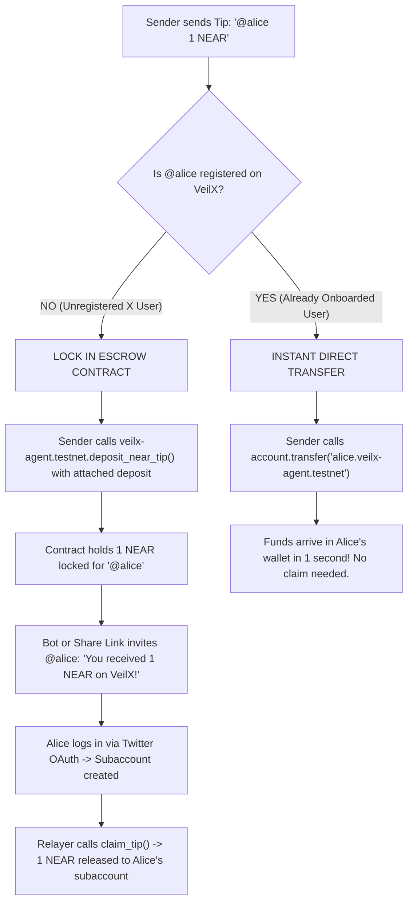

# VEILX AGENT — BLOCKING PRODUCT & ARCHITECTURE DECISIONS (APPROVED BASELINE)

**Document Version:** 1.1.0  
**Status:** USER REVIEWED & RESOLVED — IMPLEMENTATION SPECIFICATION APPROVED  
**Date of Alignment:** November 8, 2026  

---

## 1. USER DECISION RECORD & RESOLUTION SUMMARY

| Decision # | Area | User Decision / Direction | Target Behavior |
|---|---|---|---|
| **Decision 1** | Multi-Environment Support | **Dynamic UI Toggle** | Provide dynamic UI toggle between Mainnet and Testnet with strict network guards. |
| **Decision 2** | 1Click Solvers on Testnet | **Simulated / Mocked for Demo with Explicit Warning Badge** | In Testnet mode, simulate 1Click swap for demo purposes, explicitly badged as "Simulated Demo / Unavailable on Testnet". On Mainnet, use real 1Click solver. |
| **Decision 3** | Social Tipping Model | **Option A (Direct if Registered, Escrow if Unregistered)** | New/unregistered X users get escrow tips locked in smart contract; onboarded users get instant direct wallet transfers. |
| **Decision 4** | Relayer Gas Sponsorship | **Option A (Protocol Fee Deduction)** | On Mainnet, deduct fixed relayer fee (e.g. 0.05 NEAR / 0.10 USDC) from claimed tip to fund relayer gas. Free on Testnet. |
| **Decision 5** | EVM MPC Signing Authority | **Option B (Client-Signed MPC Calls)** | User's browser session key signs `v1.signer` calls directly from subaccount; user pays MPC gas. Relayer does not hold signing authority. |
| **Decision 6** | Tokenized Stocks & 1Click | **Simulated / Paper Sandbox (Explained in Detail Below)** | Stocks are not on 1Click solvers. Terminal acts as Paper Trading Sandbox; real swaps in terminal handle real crypto pairs. |
| **Decision 7** | Phantom 0.5 Shares Holdings | **Option A on Mainnet; Mock Demo on Testnet** | Mainnet starts with clean 0.00 balance; Testnet provides simulated demo holdings clearly labeled as paper assets. |
| **Decision 8** | External Wallet Signing | **Option A (Full Multi-Wallet Support)** | Dispatches signing to Meteor / Sender when connected; falls back to embedded session key when disconnected. |
| **Decision 9** | Subaccount Key Registration | **Option A (Transparent Auto-Heal)** | Relayer executes `AddKey` if active browser session key is not registered on-chain for the subaccount. |
| **Decision 10** | In-Flight Environment Switching | **Option A (Strict Environment Lock)** | Environment toggle is disabled while any transaction is broadcasting or awaiting solver fill. |
| **Decision 11** | PayLink Authorization | **Option A (Require Authenticated Session)** | PayLinks can only be created by authenticated users matching the session handle. |
| **Decision 12** | Insecure Private Key Parameters | **Option A (Immediate Removal)** | Completely remove `senderPrivateKey` parameters from all API routes. Enforce client-side signing. |
| **Decision 13** | Intent Expiration & Refund State | **Option A (120s Timeout with Auto-Refund State)** | Poll solver status up to 120s; transition to `REFUNDED` / `EXPIRED` if solver fails. |
| **Decision 14** | Automated DCA & Rebalancing | **Delegated Session Key Architecture (Explained in Detail Below)** | Explaining smart contract vs delegated session key automation. Initial implementation uses session keys with spending limits. |

---

## 2. DETAILED ANSWERS & CLARIFICATIONS TO USER QUESTIONS

---

### Decision 3 Deep Dive: "The essence of tipping is tipping X users who haven't registered before. Can Option A still work?"

**YES — Option A is specifically designed to make viral tipping to unregistered users work seamlessly!**

Here is exactly how Option A works in practice:

* **For unregistered X users:** The tip is locked into the **Escrow Smart Contract** (`veilx-agent.testnet`). Their funds are 100% safe on-chain. When they see the tip tweet/link and log into VeilX, their wallet is generated, and the escrow contract automatically pays out to their new subaccount. If they never join within 7 days, the sender can click **Refund**.
* **For users who already use VeilX:** Because they already have an active on-chain subaccount, there is no need to make them go through a claim button or pay relayer gas. The funds arrive in their balance instantly.

---

### Decision 6 Deep Dive: "What does trading actually mean? Can I buy stocks via Ondo through 1Click?"

#### 1. What does the VeilX codebase currently do?
In `src/lib/trading-copilot.ts` and `src/app/terminal/page.tsx`, when you click "Buy TSLAon" or "Sell NVDAon":
* It **does NOT** call any blockchain contract.
* It **does NOT** call Ondo Finance.
* It **does NOT** swap any tokens through 1Click.
* It simply modifies numbers in your browser's `localStorage` and saves a row to MongoDB! It is **100% simulated paper trading**.

#### 2. Can you buy stocks via Ondo through 1Click?
* **No.** Defuse 1Click solvers (`https://1click.chaindefuser.com/v0/tokens`) support **crypto tokens** (NEAR, Bitcoin, Ethereum, Solana, Base, USDC, USDT, Dogecoin, etc.).
* Solvers do **not** have liquidity or order books for US equities like Tesla (`TSLA`) or Nvidia (`NVDA`) stock tokens.
* Ondo Finance primarily issues tokenized US Treasuries (`OUSG`, `USDY`) on Ethereum and Solana. Ondo does not run a public, permissionless US equity DEX on NEAR.
* Tokenized stocks (issued by entities like Dinari or Backed Finance) operate on EVM chains and require strict KYC compliance due to SEC securities laws.

#### 3. What does "Trading" mean for VeilX Agent?
* **On Testnet:** The Stock Terminal acts as a **Paper Trading Sandbox & Copilot Simulator**. You can test AI trading commands, simulate DCA rules, and test portfolio analytics without risking real money. A badge will clearly say: `"Simulated Paper Trading"`.
* **On Mainnet:** 
  * For **crypto trading**, 1Click will execute **real cross-chain swaps** (e.g. NEAR <-> USDC, SOL, BTC, ETH) with real solvers.
  * For **stocks**, until a licensed tokenized equity broker API (such as Dinari) is officially partnered, stocks will remain in "Paper Trading" mode so users can test trading strategies safely.

---

### Decision 14 Deep Dive: "Explain better: Automated DCA & Rebalancing Smart Contract Architecture"

#### 1. What are Automated DCA and Rebalancing?
* **DCA (Dollar Cost Averaging):** *"Every Monday at 9:00 AM, automatically buy $10 of NEAR using my USDC."*
* **Portfolio Rebalancing:** *"Keep my portfolio at 50% NEAR and 50% USDC. If NEAR pumps and becomes 70%, automatically sell 20% to rebalance."*

#### 2. Why is this difficult on a blockchain?
* When you trade normally, you are sitting at your computer, you click "Confirm", and your browser key signs the transaction.
* But for **automated** DCA at 3:00 AM on a Monday:
  * **Your browser is closed.**
  * **Blockchains do not have internal timers** to run jobs on their own.
  * A transaction can only occur if an external process (a "Keeper" or server cron) sends and signs the transaction.
  * That server must have **authorized permission** to move your funds without you being there!

#### 3. How do we solve this securely in VeilX?
We have two architectural approaches:

```mermaid
graph TD
    subgraph ApproachA["Approach A: Delegated Session Key + Spending Limit (VeilX Native)"]
        UserA["User activates DCA: '$10/week'"] --> KeyGen["Browser generates Delegated Session Key with $50 spending limit"]
        KeyGen --> KeeperA["VeilX Server Keeper runs hourly cron"]
        KeeperA --> CheckLimit["Keeper verifies: Amount <= Spending Limit ($10 <= $50)"]
        CheckLimit --> ExecuteA["Keeper broadcasts swap using Delegated Key"]
    end

    subgraph ApproachB["Approach B: On-Chain Escrow Vault Smart Contract"]
        UserB["User deposits 100 USDC into Vault Contract"] --> VaultRule["Contract Rule: Max 10 USDC can be withdrawn per 7 days"]
        VaultRule --> KeeperB["Decentralized Keeper pings Vault Contract"]
        KeeperB --> ExecuteB["Vault executes swap on DEX and stores bought NEAR in Vault"]
    end
```

* **Recommended for VeilX (Approach A):**
  VeilX already has a `spendingLimitUsd` and `spentUsd` field in `src/models/User.ts`! 
  When you enable DCA, your browser grants the server permission to execute trades **up to your strict spending limit** (e.g. max $50). The server cron worker can execute your scheduled DCA trades, but can **never** steal more than the spending limit.
* **On Testnet / Initial Release:** DCA and Rebalancing will be simulated in the Paper Trading terminal to verify your trading algorithms before real capital is committed.

---

## 3. NEXT STEPS: AUTHORIZED PHASE 1 IMPLEMENTATION

With all 14 decisions resolved, we are ready to proceed with **Phase 1 Implementation**:

1. **`TASK-EVM-01`**: Fix Base Sepolia EIP-1559 fee calculation (`near-chain-signatures.ts`) — Eliminate the $1.0\text{ gwei}$ crash and add explicit gas limits.
2. **`TASK-INT-01`**: Fix Omnichain Intent Status — In Testnet mode, simulate swap with clear "Testnet Demo" badge; on Mainnet, poll real solver status.
3. **`TASK-SEC-01`**: Remove `senderPrivateKey` parameters from `/api/near/withdraw` and `/api/evm/send-mpc`.
4. **`TASK-SEC-02`**: Enforce secure `SESSION_SECRET` on server initialization.
5. **`TASK-NEAR-01`**: Branch social tipping: Direct transfer for registered subaccounts, Escrow deposit for unregistered handles.
6. **`TASK-DASH-01`**: Fix Dashboard portfolio — Purge default $0.5\text{ shares}$ ($629.82) on clean accounts, provide simulated demo assets on Testnet.

*Specification updated and certified for immediate implementation execution.*
