# VEILX AGENT — MASTER BLOCKCHAIN IMPLEMENTATION & VERIFICATION TASKS

**Document Version:** 1.0.0  
**Audit Reference:** `VEILX_BLOCKCHAIN_WEB3_TRANSACTION_AUDIT.md`  
**Remediation Plan Reference:** `VEILX_BLOCKCHAIN_REMEDIATION_PLAN.md`  
**Status:** TASK BREAKDOWN & VERIFICATION PROTOCOL (PENDING USER APPROVAL)  

---

## 1. IMPLEMENTATION PHASING & DEPENDENCY GRAPH

Implementation is partitioned into 7 sequential phases. Tasks within the same phase that do not share file-level dependencies may be executed in parallel.

```mermaid
graph TD
    subgraph Phase1["Phase 1: Immediate Financial Safety & Key Sanitization"]
        T_EVM_01["TASK-EVM-01: Fix EIP-1559 Fee Cap & Gas Limits"]
        T_INT_01["TASK-INT-01: Remove Intent Hash Fabrication & Add Polling"]
        T_SEC_01["TASK-SEC-01: Purge Plaintext Private Key Transmission"]
        T_SEC_02["TASK-SEC-02: Enforce Production Session Secret"]
    end

    subgraph Phase2["Phase 2: Core NEAR Transaction & Account Reliability"]
        T_NEAR_01["TASK-NEAR-01: Branch Social Tip (Direct vs Escrow)"]
        T_NEAR_02["TASK-NEAR-02: Fix RPC Verification Signer Parameter"]
        T_NEAR_03["TASK-NEAR-03: Auto-Heal Subaccount Session Keys"]
        T_PAY_01["TASK-PAY-01: Fix PayLink Verification & Authentication"]
    end

    subgraph Phase3["Phase 3: Multi-Environment Routing & Network Isolation"]
        T_ENV_01["TASK-ENV-01: Centralized Network & Route Selector"]
        T_EVM_02["TASK-EVM-02: Refactor NEAR MPC EVM Derivation Authority"]
        T_WALLET_01["TASK-WALLET-01: Unified Wallet Signer Adapter"]
    end

    subgraph Phase4["Phase 4: Real Protocol Integration & Terminal Segregation"]
        T_INT_02["TASK-INT-02: Genuine Defuse 1Click Solver Integration"]
        T_TERM_01["TASK-TERM-01: Isolate Paper Trading from Real Crypto"]
        T_DASH_01["TASK-DASH-01: Normalize Portfolio Holdings (Purge 0.5 shares)"]
    end

    subgraph Phase5["Phase 5: Backend Reliability, Rate Limiting & Reconciliation"]
        T_SEC_03["TASK-SEC-03: Persistent MongoDB Sliding-Window Rate Limiter"]
        T_RELAY_01["TASK-RELAY-01: Hardened Gasless Relayer Engine"]
        T_REC_01["TASK-REC-01: On-Chain Escrow & Intent State Reconciler"]
    end

    subgraph Phase6["Phase 6: Comprehensive Verification & Release Gates"]
        T_TEST_01["TASK-TEST-01: Automated Test Suite Repair & Execution"]
        T_GATE_01["TASK-GATE-01: Testnet Staging Verification Protocol"]
        T_GATE_02["TASK-GATE-02: Mainnet Controlled Deployment Audit"]
    end

    Phase1 --> Phase2
    Phase2 --> Phase3
    Phase3 --> Phase4
    Phase4 --> Phase5
    Phase5 --> Phase6
```

---

## 2. DETAILED IMPLEMENTATION TASK SPECIFICATIONS

---

### Phase 1: Immediate Financial Safety & Key Sanitization

#### TASK-EVM-01: Dynamic EIP-1559 Fee Calculation & Gas Limit Handling
* **Task ID:** `TASK-EVM-01`
* **Related Issue IDs:** `ISSUE-CHAIN-01`, `TX-FAIL-01`, `TX-FAIL-02`
* **Environment:** Both (Base Sepolia & Base Mainnet)
* **Priority:** **P0 (Critical Blocker)**
* **Objective:** Eliminate `viem` fee cap crash and missing gas parameter on Base EVM transactions.
* **Root Cause:** In `near-chain-signatures.ts:267,297`, `maxPriorityFeePerGas` is hardcoded to $1\text{ gwei}$ while Base Sepolia `maxFeePerGas` is $\approx 0.0072\text{ gwei}$. Missing `gas` limit.
* **Files Affected:** `src/lib/near-chain-signatures.ts`, `src/app/api/evm/send-mpc/route.ts`
* **Implementation Plan:**
  1. Fetch `baseFeePerGas` from latest block.
  2. Estimate priority fee dynamically using `publicClient.estimateMaxPriorityFeePerGas()`.
  3. Clamp `maxPriorityFeePerGas <= baseFeePerGas / 2n`.
  4. Compute `maxFeePerGas = (baseFeePerGas * 15n / 10n) + maxPriorityFeePerGas`.
  5. Add explicit `gas` limit: Estimate via `estimateContractGas` for ERC-20 transfers (fallback: `65000n`) or `21000n` for native ETH.
* **Dependencies:** None.
* **Risks:** Underestimating gas could cause out-of-gas reverts; 10% gas buffer mitigates this.
* **Acceptance Criteria:** `viem.serializeTransaction(unsignedTx)` successfully serializes Base Sepolia and Base Mainnet transactions without errors across fee ranges from $0.001\text{ gwei}$ to $50\text{ gwei}$.
* **Rollback Plan:** Git revert `near-chain-signatures.ts`.

#### TASK-INT-01: Omnichain Intent Settlement Engine (Real Mainnet Tracking & Testnet Demo Sandbox)
* **Task ID:** `TASK-INT-01`
* **Related Issue IDs:** `ISSUE-CHAIN-03`, `TX-FAIL-06`
* **Environment:** Both (Real Polling on Mainnet; Simulated Demo with Explicit Warning Badge on Testnet)
* **Priority:** **P0 (Critical Blocker)**
* **Objective:** Cease reusing source deposit hashes as destination hashes; track real solver fills on Mainnet, and provide an explicit simulated sandbox on Testnet for demos.
* **Root Cause:** `ChatContainer.tsx:869` immediately sets `destinationTxHash = depositTxHash` and patches `/api/intents` with `status: "success"`.
* **Files Affected:** `src/components/chat/ChatContainer.tsx`, `src/lib/1click.ts`, `src/app/api/intents/route.ts`
* **Implementation Plan:**
  1. On Mainnet: Set initial intent status to `deposited` upon source transaction confirmation. Trigger `pollIntentExecution(depositAddress, 120000)` in background. Update order in MongoDB only when solver status is `SUCCESS`, capturing `data.swapDetails.destinationTxHash`. If `REFUNDED` or `EXPIRED`, update state accordingly.
  2. On Testnet: Allow the swap to complete in simulated demo mode so it can be demonstrated to users/investors, but display an explicit badge: `[ Testnet Demo — Simulated Swap ]` and clear banner: `Route unavailable on Testnet; simulated for demonstration`.
* **Dependencies:** None.
* **Risks:** Solver delays may cause user to wait 30–60 seconds on Mainnet; explicit spinner UX mitigates confusion.
* **Acceptance Criteria:** On Mainnet, zero database records contain identical `depositTxHash` and `destinationTxHash`. On Testnet, demo execution clearly displays the simulation badge.
* **Rollback Plan:** Revert `ChatContainer.tsx` intent handler.

#### TASK-SEC-01: Purge Plaintext Private Key Transmission
* **Task ID:** `TASK-SEC-01`
* **Related Issue IDs:** `ISSUE-CHAIN-11`, `TX-FAIL-12`
* **Environment:** Both
* **Priority:** **P0 (Critical Security)**
* **Objective:** Ensure no endpoint accepts or processes private keys over HTTP.
* **Root Cause:** `api/near/withdraw/route.ts:79` and `api/evm/send-mpc/route.ts:39` accept `senderPrivateKey`.
* **Files Affected:** `src/app/api/near/withdraw/route.ts`, `src/app/api/evm/send-mpc/route.ts`
* **Implementation Plan:**
  1. Remove `senderPrivateKey` from TypeScript request interfaces and destructuring.
  2. Reject requests containing `senderPrivateKey` with HTTP 400 (`"Insecure key transmission prohibited"`).
  3. Enforce that withdrawals must be signed client-side via `near-client-signer.ts` or external wallet.
* **Dependencies:** None.
* **Risks:** Legacy automated test scripts sending keys will fail; update scripts to use client signer.
* **Acceptance Criteria:** Static code analysis confirms zero occurrences of `senderPrivateKey` in `/api`.
* **Rollback Plan:** Revert endpoint changes.

#### TASK-SEC-02: Enforce Production Session Secret Integrity
* **Task ID:** `TASK-SEC-02`
* **Related Issue IDs:** `ISSUE-CHAIN-08`, `TX-FAIL-11`
* **Environment:** Both
* **Priority:** **P1**
* **Objective:** Prevent session forgery via hardcoded default secrets.
* **Root Cause:** `src/lib/session.ts:5` falls back to a hardcoded string if `SESSION_SECRET` is unset.
* **Files Affected:** `src/lib/session.ts`
* **Implementation Plan:**
  1. If `process.env.NODE_ENV === "production"` and `!process.env.SESSION_SECRET`, throw fatal initialization error.
  2. Require `SESSION_SECRET` length >= 32 characters.
* **Dependencies:** None.
* **Risks:** App fails to start if environment is misconfigured; properly document in `.env.example`.
* **Acceptance Criteria:** Server crashes on startup if `SESSION_SECRET` is missing in production mode.
* **Rollback Plan:** Revert `session.ts`.

---

### Phase 2: Core NEAR Transaction & Account Reliability

#### TASK-NEAR-01: Branch Social Tipping Flow (Direct vs Escrow)
* **Task ID:** `TASK-NEAR-01`
* **Related Issue IDs:** `ISSUE-CHAIN-02`, `TX-FAIL-03`
* **Environment:** Both
* **Priority:** **P0**
* **Objective:** Stop contract reverts by aligning tipping execution with storage model.
* **Root Cause:** `ChatContainer.tsx:424` executes native account transfer, but logs it as an escrow deposit. Claims revert with `"Tip not found"`.
* **Files Affected:** `src/components/chat/ChatContainer.tsx`, `src/app/api/near/send-tip/route.ts`, `src/app/api/relay/claim/route.ts`
* **Implementation Plan:**
  1. If recipient has an existing subaccount (`recipient.veilx-agent.testnet`), execute direct transfer `account.transfer()`. Record in DB as `type: "direct_deposit"`, `status: "completed"`. No claim card is generated.
  2. If recipient is unregistered or tip is explicitly marked "Escrow Tip", call `account.functionCall({ contractId: CONTRACT_ID, methodName: "deposit_near_tip", args: { tip_id, recipient_handle }, attachedDeposit: yoctoNear })`.
  3. Relayer claim endpoint verifies tip exists in contract before executing `claim_tip`.
* **Dependencies:** `TASK-NEAR-03`.
* **Risks:** Contract deposit requires attached gas (30 Tgas) and storage deposit (0.01 NEAR).
* **Acceptance Criteria:** Direct tips complete immediately without claim cards; escrow tips can be claimed via `/api/relay/claim` without on-chain revert.
* **Rollback Plan:** Revert `ChatContainer.tsx` tip handler.

#### TASK-NEAR-02: Fix RPC Verification Signer Parameter
* **Task ID:** `TASK-NEAR-02`
* **Related Issue IDs:** `ISSUE-CHAIN-05`, `TX-FAIL-04`
* **Environment:** Both
* **Priority:** **P1**
* **Objective:** Enable legitimate withdrawals to pass on-chain verification.
* **Root Cause:** `api/near/withdraw/route.ts:44` passes `cleanRecipient` to `verifyNearTransactionOutcome()`.
* **Files Affected:** `src/app/api/near/withdraw/route.ts`
* **Implementation Plan:**
  1. Extract `senderWallet` from authenticated session or verified request body.
  2. Call `verifyNearTransactionOutcome(txHash, senderWallet)`.
* **Dependencies:** None.
* **Risks:** None.
* **Acceptance Criteria:** Valid withdrawal transaction hashes return `verified: true`.
* **Rollback Plan:** Revert `withdraw/route.ts`.

#### TASK-NEAR-03: Subaccount Session Key Transparent Registration
* **Task ID:** `TASK-NEAR-03`
* **Related Issue IDs:** `ISSUE-CHAIN-12`
* **Environment:** Both
* **Priority:** **P0**
* **Objective:** Resolve `"Personal wallet key not authorized on-chain"` errors.
* **Root Cause:** If subaccount exists, new browser session keys are not added to the account's access key list.
* **Files Affected:** `src/lib/near-utils.ts`, `src/app/api/user/route.ts`
* **Implementation Plan:**
  1. In `/api/user` POST handler, query `view_access_key_list` for user's subaccount.
  2. If browser `publicKey` is missing, relayer calls `account.addKey(publicKey)`.
* **Dependencies:** None.
* **Risks:** Relayer consumes small amount of gas to add key.
* **Acceptance Criteria:** Users can sign and broadcast transactions immediately upon browser login.
* **Rollback Plan:** Revert `user/route.ts`.

#### TASK-PAY-01: Fix PayLink Verification & Enforce Authentication
* **Task ID:** `TASK-PAY-01`
* **Related Issue IDs:** `ISSUE-CHAIN-06`, `ISSUE-CHAIN-15`, `TX-FAIL-05`
* **Environment:** Both
* **Priority:** **P1**
* **Objective:** Allow invoice settlements to pass verification; protect invoice creation.
* **Root Cause:** `api/paylinks/route.ts:160` verifies invoice creator instead of payer; POST lacks session auth.
* **Files Affected:** `src/app/api/paylinks/route.ts`
* **Implementation Plan:**
  1. Pass payer account ID to `verifyNearTransactionOutcome()`.
  2. Enforce `verifySessionToken()` on `POST /api/paylinks`.
* **Dependencies:** None.
* **Risks:** Unauthenticated scripts creating invoices will be blocked.
* **Acceptance Criteria:** Invoices mark settled upon valid payer transaction; unauthenticated invoice creation rejected with 401.
* **Rollback Plan:** Revert `paylinks/route.ts`.

---

### Phase 3: Multi-Environment Routing & Network Isolation

#### TASK-ENV-01: Centralized Network & Route Selector Service
* **Task ID:** `TASK-ENV-01`
* **Related Issue IDs:** Architectural Mandate
* **Environment:** Both
* **Priority:** **P1**
* **Objective:** Implement deterministic route selection and strict environment isolation.
* **Files Affected:** `src/lib/route-selector.ts` (New), `src/context/NetworkContext.tsx` (New)
* **Implementation Plan:**
  1. Create `RouteSelector` singleton querying network availability and asset support.
  2. Block 1Click solver execution when in `testnet` environment.
  3. Add environment state to UI header with explicit visual badges (`[ TESTNET ]` vs `[ MAINNET ]`).
* **Dependencies:** Phase 1 & 2 complete.
* **Risks:** UI refactoring must not break existing navigation.
* **Acceptance Criteria:** Attempting to execute a Mainnet-only swap in Testnet displays explicit unavailability badge.
* **Rollback Plan:** Delete new modules.

#### TASK-EVM-02: Client-Signed NEAR MPC EVM Derivation (Option B)
* **Task ID:** `TASK-EVM-02`
* **Related Issue IDs:** `ISSUE-CHAIN-04`, `TX-FAIL-08`
* **Environment:** Both
* **Priority:** **P1**
* **Objective:** Enable direct client-signed calls to `v1.signer-prod.testnet` / `v1.signer` from the user's subaccount, eliminating relayer authorization mismatch.
* **Root Cause:** Relayer key in `/api/evm/send-mpc` lacks authorization to sign MPC requests on behalf of arbitrary user subaccounts.
* **Files Affected:** `src/lib/near-chain-signatures.ts`, `src/app/api/evm/send-mpc/route.ts`
* **Implementation Plan:**
  1. Refactor MPC call in `near-chain-signatures.ts` to execute via `near-client-signer.ts` from the user's authenticated subaccount.
  2. Subaccount attaches 300 Tgas for MPC network threshold signing.
  3. Relayer key is decoupled from user EVM MPC signatures.
* **Dependencies:** `TASK-NEAR-03`.
* **Risks:** User must have at least 0.05 NEAR on their subaccount for MPC gas.
* **Acceptance Criteria:** User subaccount directly requests and receives Secp256k1 MPC signature from NEAR testnet signer contract.
* **Rollback Plan:** Revert `near-chain-signatures.ts`.

#### TASK-WALLET-01: Unified Wallet Signer Adapter (`IWalletSigner`)
* **Task ID:** `TASK-WALLET-01`
* **Related Issue IDs:** `ISSUE-CHAIN-09`, `TX-FAIL-09`
* **Environment:** Both
* **Priority:** **P1**
* **Objective:** Enable Meteor and Sender wallets to sign chat transactions.
* **Files Affected:** `src/lib/wallet-adapter.ts` (New), `src/components/chat/ChatContainer.tsx`, `src/lib/near-wallet-connector.ts`
* **Implementation Plan:**
  1. Implement `IWalletSigner` interface.
  2. Wrap `near-client-signer.ts` for embedded session keys.
  3. Wrap Meteor/Sender provider for external wallets.
  4. Dispatch signing in `ChatContainer.tsx` through active `IWalletSigner`.
* **Dependencies:** `TASK-ENV-01`.
* **Risks:** Different wallets handle popup approval flows differently.
* **Acceptance Criteria:** Connected Meteor wallet successfully signs a tip or contract call from Chat UI.
* **Rollback Plan:** Revert `ChatContainer.tsx` wallet references.

---

### Phase 4: Real Protocol Integration & Terminal Segregation

#### TASK-TERM-01: Trading Terminal Architecture (Paper Sandbox & Regulation S Compliant Routing)
* **Task ID:** `TASK-TERM-01`
* **Related Issue IDs:** `ISSUE-CHAIN-07`, `TX-FAIL-07`
* **Environment:** Both (Paper Sandbox on Testnet; Reg S Compliant / Paper Mode on Mainnet)
* **Priority:** **P1**
* **Objective:** Prevent simulated equity trades from masquerading as real on-chain assets on Testnet, while enabling compliant NEAR Intents swaps for eligible non-U.S. users on Mainnet.
* **Files Affected:** `src/app/terminal/page.tsx`, `src/lib/trading-copilot.ts`, `src/lib/1click.ts`
* **Implementation Plan:**
  1. On Testnet: Add prominent `"Paper Trading / Simulation Mode"` banner across terminal header. Label order executions as `"Simulated Paper Order Executed"`. Ensure simulated holdings do not artificially inflate on-chain crypto net worth.
  2. On Mainnet: Implement jurisdiction check. For eligible non-U.S. users, route swaps into Ondo equities (`TSLAon`, `NVDAon`) through compliant NEAR Intents partner solver. For U.S. and restricted persons, display Regulation S disclosure and keep terminal in Paper Trading simulation mode.
* **Dependencies:** None.
* **Risks:** Regulatory compliance risk if geofence is bypassed; default to Paper Trading if location cannot be verified.
* **Acceptance Criteria:** Terminal UI unambiguously communicates simulation status on Testnet; Mainnet enforces Regulation S eligibility checks before real equity execution.
* **Rollback Plan:** Revert `terminal/page.tsx`.

#### TASK-DASH-01: Portfolio Holdings Normalization (Purge 0.5 Shares Bug)
* **Task ID:** `TASK-DASH-01`
* **Related Issue IDs:** User Attachment Bug
* **Environment:** Both
* **Priority:** **P1**
* **Objective:** Eliminate phantom $629.82 net worth for new users.
* **Files Affected:** `src/components/dashboard/TransactionDashboard.tsx`, `src/components/modals/StockOnboardingModal.tsx`
* **Implementation Plan:**
  1. Set initial equity holdings strictly to 0 shares.
  2. Only display positions when `shares > 0`.
* **Dependencies:** None.
* **Risks:** Existing demo accounts will show 0 holdings.
* **Acceptance Criteria:** New accounts open with $0.00 stock balance and 0 active positions.
* **Rollback Plan:** Revert dashboard initialization.

---

### Phase 5: Backend Reliability, Rate Limiting & Reconciliation

#### TASK-SEC-03: Persistent MongoDB Sliding-Window Rate Limiter
* **Task ID:** `TASK-SEC-03`
* **Related Issue IDs:** `ISSUE-CHAIN-10`, `TX-FAIL-10`
* **Environment:** Both
* **Priority:** **P2**
* **Objective:** Ensure faucet and claim rate limits persist across serverless cold starts.
* **Files Affected:** `src/lib/rate-limiter.ts`, `src/models/RateLimit.ts` (New)
* **Implementation Plan:**
  1. Create Mongoose model `RateLimit` with TTL expiration index.
  2. Replace in-memory `Map` with atomic `findOneAndUpdate` sliding window.
* **Dependencies:** None.
* **Risks:** Adds minor database latency to rate-limited endpoints.
* **Acceptance Criteria:** Rate limits enforced consistently across server restarts.
* **Rollback Plan:** Revert `rate-limiter.ts`.

#### TASK-RELAY-01: Hardened Gasless Relayer Engine
* **Task ID:** `TASK-RELAY-01`
* **Related Issue IDs:** Relayer Failure Audit
* **Environment:** Both
* **Priority:** **P1**
* **Objective:** Add concurrency controls, gas alerts, and fee deduction to relayer.
* **Files Affected:** `src/app/api/relay/claim/route.ts`
* **Implementation Plan:**
  1. Add balance threshold monitoring for `ESCROW_PRIVATE_KEY`.
  2. Implement atomic mutex lock preventing double-claim race conditions.
  3. On Mainnet, enforce fee deduction to replenish gas.
* **Dependencies:** `TASK-NEAR-01`.
* **Risks:** Relayer downtime blocks claims; fallback to self-claim UX mitigates this.
* **Acceptance Criteria:** Concurrent claim requests for the same tip ID process exactly once.
* **Rollback Plan:** Revert `relay/claim/route.ts`.

---

### Phase 6: Comprehensive Verification & Release Gates

#### TASK-TEST-01: Automated Test Suite Repair & Execution
* **Task ID:** `TASK-TEST-01`
* **Related Issue IDs:** Audit Section 20
* **Environment:** Both
* **Priority:** **P1**
* **Objective:** Fix CommonJS/ESM module errors in test scripts and run regression suite.
* **Files Affected:** `scripts/test-phase4-stealth-mpc.mjs`, `scripts/test-near-escrow.mjs`
* **Implementation Plan:**
  1. Fix `import { ec } from 'elliptic'` to CommonJS `createRequire`.
  2. Add automated end-to-end test runner validating all Phase 1–5 fixes.
* **Dependencies:** Phases 1–5 complete.
* **Risks:** None.
* **Acceptance Criteria:** Test suite runs to 100% completion with exit code 0.
* **Rollback Plan:** Revert test scripts.

---

## 3. MASTER TEST & VERIFICATION PROTOCOL

| Test ID | Related Issue | Environment | Preconditions | Execution Steps | Expected Outcome | Pass/Fail Criteria |
|---|---|---|---|---|---|---|
| **TEST-EVM-01** | `ISSUE-CHAIN-01` | Base Sepolia | Derived EVM account with 5 test USDC | Call `createAndSignBaseTransaction` for 5 USDC transfer | Transaction serializes, signs via MPC, broadcasts, returns valid BaseScan txHash | Tx confirmed on Base Sepolia explorer |
| **TEST-EVM-02** | `TX-FAIL-02` | Base Sepolia | Base Sepolia gas price < 0.01 gwei | Request EIP-1559 transaction construction | `maxPriorityFeePerGas <= maxFeePerGas`; explicit `gas` present | Serialization does not throw exception |
| **TEST-NEAR-01** | `ISSUE-CHAIN-02` | NEAR Testnet | Sender wallet funded with 1 NEAR | Send tip to `@unregistered_user` | Contract `deposit_near_tip` called; receipt shows attached deposit | `get_tip(tip_id)` returns `Some(TipRecord)` on-chain |
| **TEST-NEAR-02** | `ISSUE-CHAIN-02` | NEAR Testnet | Recipient of `TEST-NEAR-01` | Call `/api/relay/claim` for `tip_id` | Contract `claim_tip` succeeds; funds transferred to recipient | Status updated to `claimed`; no contract panic |
| **TEST-NEAR-03** | `ISSUE-CHAIN-12` | NEAR Testnet | Subaccount exists without active session key | Log into browser; trigger balance query | Relayer executes `AddKey`; key visible in `view_access_key_list` | User can broadcast tx without auth error |
| **TEST-INT-01** | `ISSUE-CHAIN-03` | Mainnet | Sender deposits NEAR to 1Click address | Execute cross-chain intent order | Status remains `deposited`; poller awaits solver fill; real destination txHash logged | `destinationTxHash != depositTxHash` |
| **TEST-PAY-01** | `ISSUE-CHAIN-06` | NEAR Testnet | Active PayLink with 0.1 NEAR price | Payer settles invoice via `account.transfer` | Call `/api/paylinks` settlement with payer txHash | Status updates to `settled`; no RPC error |
| **TEST-SEC-01** | `ISSUE-CHAIN-11` | Both | HTTP client | Send `POST /api/near/withdraw` with `senderPrivateKey` | Server rejects with HTTP 400 | No private key logged or processed |
| **TEST-SEC-02** | `ISSUE-CHAIN-10` | Both | Automated script | Send 20 faucet requests within 10 seconds | Requests 11–20 rejected with HTTP 429 across server restarts | Rate limit persists in MongoDB |

---

*Implementation Tasks & Verification Plan compiled for engineering authorization.*
