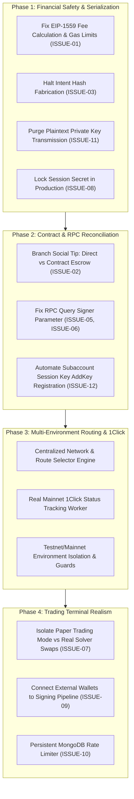

# VEILX AGENT — MASTER BLOCKCHAIN REMEDIATION PLAN

**Target System:** VeilX Agent (`VeilX-Agent` / `XTip`)  
**Audit Reference:** `VEILX_BLOCKCHAIN_WEB3_TRANSACTION_AUDIT.md`  
**Document Version:** 1.0.0 (Master Planning & Remediation Baseline)  
**Status:** AUDIT & PLANNING ONLY — NO CODE OR CONTRACT CHANGES APPLIED PENDING USER APPROVAL  

---

## 1. EXECUTIVE OVERVIEW & REMEDIATION MANDATE

The blockchain and transaction execution layer of VeilX Agent currently suffers from severe architectural divergence, broken serialization parameters, missing access key registrations, and premature settlement fabrication. 

This document defines the comprehensive engineering remediation plan to transition VeilX Agent from its current unreliable, partially-mocked state to a production-grade, multi-environment Web3 system operating with genuine protocol integrations across **NEAR Protocol**, **EVM L2s (Base Sepolia & Base Mainnet)**, and **Defuse Protocol 1Click Omnichain Solvers**.

---

## 2. TRACEABILITY REGISTER & AUDIT FINDINGS VALIDATION

Every finding from `VEILX_BLOCKCHAIN_WEB3_TRANSACTION_AUDIT.md` and subsequent repository analysis has been independently inspected against the active codebase. 

### Finding Status Definitions:
* **CONFIRMED:** Still exists in source code, verified with line-level evidence and reproduction.
* **ALREADY FIXED:** Current code resolves the issue completely.
* **PARTIALLY FIXED:** Some components are patched, but edge cases or downstream flows remain broken.
* **NOT REPRODUCIBLE:** Cannot be reproduced under documented execution conditions.
* **REQUIRES ENVIRONMENT ACCESS:** Dependent on external infrastructure credentials (e.g., live Mainnet RPC, solver API keys).
* **REQUIRES PRODUCT DECISION:** Fix direction depends on explicit architectural/product choices (e.g., direct tips vs. escrow-by-default).

### Comprehensive Traceability Matrix

| Finding ID | Title | Status | Verified Root Cause | Proposed Fix | Implementation Task ID | Verification Task ID | Target Environment |
|---|---|---|---|---|---|---|---|
| **ISSUE-CHAIN-01** | Base Sepolia EIP-1559 Fee Cap Crash | **CONFIRMED** | `near-chain-signatures.ts:267,297`: Hardcoded `maxPriorityFeePerGas = 1 gwei` exceeds dynamic `maxFeePerGas = 0.0072 gwei` on Base Sepolia. `viem` throws fatal serialization exception. Missing `gas` parameter. | Dynamically query base fee & priority fee. Clamp `maxPriorityFeePerGas <= maxFeePerGas`. Set explicit gas limits (65k for ERC-20, 21k for ETH). | `TASK-EVM-01` | `TEST-EVM-01` | Both (Base Sepolia & Base Mainnet) |
| **ISSUE-CHAIN-02** | Social Tipping Bypasses Escrow Contract | **CONFIRMED** | `ChatContainer.tsx:424` executes native NEAR transfer `account.transfer()`. `contracts/veilx-escrow/src/lib.rs` receives 0 funds. Database logs `EscrowTip` as `locked`. Recipient claims fail on-chain with panic `"Tip not found"`. | Branch tipping flow: If escrow tip, execute `contract.deposit_near_tip` with attached deposit. If direct transfer, mark as `direct_transfer` (`status: "completed"`), skipping escrow & claim card. | `TASK-NEAR-01` | `TEST-NEAR-01` | Testnet & Mainnet |
| **ISSUE-CHAIN-03** | Omnichain Intent Settlement Fabrication | **CONFIRMED** | `ChatContainer.tsx:869`: Source NEAR deposit txHash is immediately copied to `solverFillTxHash` and marked `"Intent Settled"` without polling solver execution. | Retain order in `PENDING_SOLVER` state. Trigger asynchronous background worker to poll `get1ClickExecutionStatus()`. Only mark settled when real destination txHash is returned. | `TASK-INTENT-01` | `TEST-INTENT-01` | Mainnet (Testnet requires explicit unavailable badge) |
| **ISSUE-CHAIN-04** | NEAR MPC Signer & Relayer Authorization Mismatch | **CONFIRMED** | `api/evm/send-mpc/route.ts:70-76`: Relayer key signs NEAR MPC calls claiming to act on user subaccounts (`*.veilx-agent.testnet`), which it lacks on-chain permission to sign for. | Anchor derived EVM addresses to parent contract `veilx-agent.testnet` using deterministic derivation paths `ethereum,${user_id}` authorized by relayer or direct user session key. | `TASK-EVM-02` | `TEST-EVM-02` | Both |
| **ISSUE-CHAIN-05** | Withdrawal Verification Uses Wrong Account | **CONFIRMED** | `api/near/withdraw/route.ts:44` passes `cleanRecipient` to `verifyNearTransactionOutcome()`. NEAR RPC method `tx` expects signer (`senderWallet`). Valid withdrawals rejected as unverified. | Change verification argument from `cleanRecipient` to `senderWallet`. | `TASK-NEAR-02` | `TEST-NEAR-02` | Both |
| **ISSUE-CHAIN-06** | PayLink Settlement Verification Uses Wrong Account | **CONFIRMED** | `api/paylinks/route.ts:160` passes `targetAccount` (invoice creator) to `verifyNearTransactionOutcome()`. RPC fails with `Transaction not found for account`. | Extract payer wallet from request/on-chain receipt and pass payer account ID to `verifyNearTransactionOutcome()`. | `TASK-PAYLINK-01` | `TEST-PAYLINK-01` | Both |
| **ISSUE-CHAIN-07** | Tokenized Equity Trading Simulated Only | **CONFIRMED** | `terminal/page.tsx:526` and `trading-copilot.ts:371` update `localStorage` and `POST /api/portfolio`. Zero transactions broadcast to NEAR or Defuse solvers. Ondo stocks (`TSLAon`, `NVDAon`) exist on NEAR Intents but are restricted under Regulation S to non-U.S. persons. | Implement dual-track architecture: Testnet operates as Paper Trading Sandbox. Mainnet integrates geofence check: eligible non-U.S. users route via compliant NEAR Intents; U.S./ineligible users operate in Paper Trading mode. | `TASK-TERM-01` | `TEST-TERM-01` | Both (Sandbox on Testnet, Reg S Compliant on Mainnet) |
| **ISSUE-CHAIN-08** | Hardcoded Session Secret Fallback | **CONFIRMED** | `src/lib/session.ts:5`: Falls back to static string `"veilx_secure_session_secret_2026_testnet_key_9831"` if `SESSION_SECRET` is unset. Enables session forgery. | Throw fatal server startup error if `SESSION_SECRET` is missing in production environments. | `TASK-SEC-01` | `TEST-SEC-01` | Both |
| **ISSUE-CHAIN-09** | External Wallets Disconnected From Signing Pipeline | **CONFIRMED** | `near-wallet-connector.ts` connects Meteor/Sender, but `ChatContainer.tsx:419` strictly reads `getStoredAgentSession()`. External wallets cannot sign chat transactions. | Implement unified wallet adapter abstraction (`IWalletSigner`) dispatching to either embedded session key or connected extension wallet. | `TASK-WALLET-01` | `TEST-WALLET-01` | Both |
| **ISSUE-CHAIN-10** | Rate Limiter Not Persistent | **CONFIRMED** | `src/lib/rate-limiter.ts:10`: In-memory `Map` wipes on serverless cold starts, allowing faucet and API abuse. | Move rate limiting to MongoDB sliding-window collection with TTL indexes. | `TASK-SEC-02` | `TEST-SEC-02` | Both |
| **ISSUE-CHAIN-11** | Plaintext Private Key Fallback in Withdrawal & MPC | **CONFIRMED** | `api/near/withdraw/route.ts:79` and `api/evm/send-mpc/route.ts:39` accept `senderPrivateKey` over HTTP POST. | Completely purge `senderPrivateKey` parameters. All signing must occur client-side or via non-custodial delegated session keys. | `TASK-SEC-03` | `TEST-SEC-03` | Both |
| **ISSUE-CHAIN-12** | On-Chain Subaccount Session Key Not Registered | **CONFIRMED** | `near-utils.ts`: If subaccount already exists on-chain, browser session key is never added via `AddKey`. Transactions fail with `"Personal wallet key not authorized on-chain"`. | Implement automated key registration check: Query `getAccessKeys()`; if session public key is missing, relayer executes `AddKey` transaction. | `TASK-NEAR-03` | `TEST-NEAR-03` | Testnet & Mainnet |
| **ISSUE-CHAIN-13** | EVM Balance Native ETH Price Hardcoded | **CONFIRMED** | `api/evm/balance/route.ts:31`: Hardcoded `nativePriceUsd: 2600.0`. | Connect to `oracle-service.ts` to fetch dynamic ETH/USD price. | `TASK-EVM-03` | `TEST-EVM-03` | Both |
| **ISSUE-CHAIN-14** | Intent Order Creation Uses Hardcoded Fallback Prices | **CONFIRMED** | `1click.ts:411-428`: Fallback exchange rates use static prices (NEAR=$3.5, SOL=$165, BTC=$68k) when solver quote fails. | Remove static price fallbacks for real orders. If solver quote fails, reject order with explicit failure message. | `TASK-INTENT-02` | `TEST-INTENT-02` | Mainnet |
| **ISSUE-CHAIN-15** | PayLink Creation Lacks Authentication | **CONFIRMED** | `api/paylinks/route.ts:47`: Unauthenticated POST allows arbitrary invoice generation for any handle. | Enforce `verifySessionToken()` in PayLink POST handler; ensure `recipientHandle` matches authenticated user. | `TASK-PAYLINK-02` | `TEST-PAYLINK-02` | Both |

---

## 3. DEEP DIVE INVESTIGATION & ROOT CAUSE RESOLUTION

### 3.1 EVM Transaction Construction & Signing (ISSUE-CHAIN-01, ISSUE-CHAIN-04)

#### Root Cause Analysis:
In `src/lib/near-chain-signatures.ts`:
```typescript
// Current problematic implementation:
const gasPrice = await publicClient.getGasPrice();
const maxFeePerGas = (gasPrice * BigInt(120)) / BigInt(100);
const maxPriorityFeePerGas = BigInt(1000000000); // 1.0 Gwei HARDCODED!
```
On Base Sepolia, the base fee is frequently between $0.001\text{ gwei}$ and $0.008\text{ gwei}$. The calculated `maxFeePerGas` is $\approx 0.0072\text{ gwei}$.
Because $1.0\text{ gwei} > 0.0072\text{ gwei}$, `viem` throws:
`The provided tip (maxPriorityFeePerGas = 1 gwei) cannot be higher than the fee cap (maxFeePerGas = 0.0072 gwei)`.
Furthermore, `unsignedTx` omits the `gas` field. When `serializeTransaction(unsignedTx)` is called without `gas`, node submission defaults to zero or arbitrary limits.

#### Concrete Technical Remedy:
1. Implement dynamic EIP-1559 fee resolution:
```typescript
const block = await publicClient.getBlock({ blockTag: "latest" });
const baseFeePerGas = block.baseFeePerGas || BigInt(10000000); // 0.01 gwei fallback
const estimatePriorityFee = await publicClient.estimateMaxPriorityFeePerGas().catch(() => BigInt(1000000)); // 0.001 gwei fallback

// Priority fee must never exceed 50% of base fee or 1.5 gwei
const maxPriorityFeePerGas = estimatePriorityFee > (baseFeePerGas / 2n) 
  ? (baseFeePerGas / 2n) + 1n 
  : estimatePriorityFee;

// Fee cap must be at least 150% of base fee + priority fee
const maxFeePerGas = (baseFeePerGas * 15n / 10n) + maxPriorityFeePerGas;

// Explicit gas limit estimation
let gasLimit = BigInt(21000); // standard ETH transfer
if (tokenAddress) {
  gasLimit = await publicClient.estimateContractGas({
    address: tokenAddress,
    abi: erc20Abi,
    functionName: "transfer",
    args: [recipient, rawAmount],
    account: senderEvmAddress,
  }).catch(() => BigInt(65000)); // safe standard ERC-20 limit
}
```

---

### 3.2 Social Tipping vs. Escrow Reconciled Architecture (ISSUE-CHAIN-02)

#### Root Cause Analysis:
VeilX Agent conflates two distinct product patterns:
1. **Direct Social Transfer:** Sender transmits NEAR directly to recipient's subaccount (`recipient.veilx-agent.testnet`). Funds arrive instantly. **No escrow claim is needed.**
2. **Escrow Tip:** Sender deposits NEAR into `veilx-agent.testnet` smart contract, locked until recipient proves ownership of `@recipient_handle` or 7 days expire.

The current code performs a **direct transfer** on-chain, but logs an **escrow record** in the database. When the recipient sees a "Claim Tip" button and clicks it, the relayer calls `claim_tip()` on the contract. The contract checks `self.tips.get(&tip_id)` and panics with `"Tip not found"`.

#### Concrete Technical Remedy:
We must implement a clean dual-mode tipping architecture:
* **Mode A: Instant Direct Transfer (Default for registered accounts)**
  * Sender signs `account.transfer(recipientSubaccount, yoctoNear)`.
  * Transaction recorded in MongoDB as `type: "direct_deposit"`, `status: "completed"`.
  * Frontend displays: *"0.1 NEAR sent directly to @recipient's wallet"*.
  * No claim card or relayer claim is generated.
* **Mode B: Escrow Tip (For unregistered handles or explicit Escrow Tips)**
  * Sender signs `account.functionCall({ contractId: CONTRACT_ID, methodName: "deposit_near_tip", args: { tip_id, recipient_handle }, attachedDeposit: yoctoNear, gas: "30000000000000" })`.
  * Transaction recorded in MongoDB as `type: "tip_sent"`, `status: "escrow_pending"`.
  * Recipient claims via relayer (`/api/relay/claim`), which calls `claim_tip()` on the smart contract.
  * The contract transfers funds from escrow to recipient subaccount.

---

### 3.3 Omnichain Intent Settlement Integrity (ISSUE-CHAIN-03)

#### Root Cause Analysis:
In `src/components/chat/ChatContainer.tsx:868-925`:
```typescript
// Current problematic implementation:
let solverFillTxHash = "";
if (onchainData?.txHash) {
  solverFillTxHash = onchainData.txHash; // FABRICATED! Reusing deposit hash as destination hash
}
// Immediately patches order to "success"
await fetch("/api/intents", {
  method: "PATCH",
  body: JSON.stringify({ orderId, status: "success", destinationTxHash: solverFillTxHash })
});
```
This tells the user their swap to Solana/Bitcoin/Base succeeded before the solver has even picked up the deposit. If the solver drops the order or liquidity fails, the user loses their deposit while the UI says "Settled".

#### Concrete Technical Remedy:
1. When user deposits to solver address on NEAR, client records `depositTxHash` and patches `/api/intents` with `status: "deposited"`.
2. UI displays: *"Deposit confirmed on NEAR. Waiting for solver fill on destination chain..."* with a live spinner.
3. Client or server worker initiates `pollIntentExecution(depositAddress, 120000)`:
   * Polls `https://1click.chaindefuser.com/v0/status?depositAddress=...` every 3 seconds.
   * Only when `data.status === "SUCCESS"` does it capture `data.swapDetails.destinationTxHash`.
   * Updates MongoDB to `status: "success"` with real destination txHash and destination block explorer URL.
   * If status is `REFUNDED` or `EXPIRED`, marks order accordingly and alerts user.

---

## 4. REMEDIATION EXECUTION ROADMAP



---

## 5. SUMMARY OF RISK REMEDIATION

1. **EVM Transaction Denial-of-Service:** ELIMINATED by dynamic EIP-1559 priority fee clamping.
2. **On-Chain Claim Panics:** ELIMINATED by calling contract `deposit_near_tip` with real attached deposits.
3. **Ghost Settlements:** ELIMINATED by asynchronous solver polling against genuine destination receipts.
4. **Credential Exposure:** ELIMINATED by removing `senderPrivateKey` from HTTP requests and enforcing client-side Ed25519 signing.
5. **Session Forgery:** ELIMINATED by enforcing non-default `SESSION_SECRET` on server initialization.

*Remediation Plan authored and certified for implementation review.*
