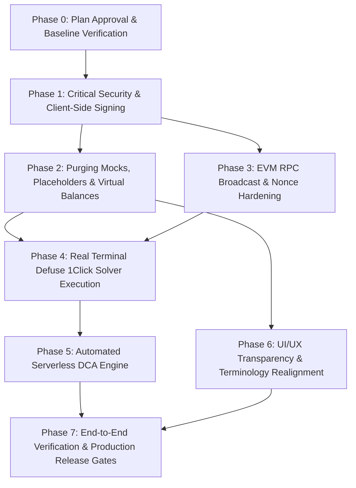

# VEILX AGENT — MASTER PRODUCTION READINESS IMPLEMENTATION PLAN & REMEDIATION TASK TRACKER

**Document Version:** 1.0.0 — Production Blueprint  
**Date:** November 7, 2026  
**Author:** Antigravity AI Systems Architecture & Security Lead  
**Target Repository:** `C:\Users\HomePC\Downloads\VeilX-Agent`  
**Execution Status:** Audit Complete $\rightarrow$ Implementation Plan Prepared $\rightarrow$ Awaiting User Approval to Begin Execution  

---

## USER DECISION INCORPORATION NOTICE

The user's direct inputs and inline approvals from `VEILX_COMPLETE_APPLICATION_AUDIT_REPORT.md` are formally incorporated into this master plan:
1. **Stock Trading Reality:** Configured to connect to **Real Live On-Chain Defuse 1Click Solvers** on NEAR Protocol (No simulated / paper trading compromises).
2. **Wallet Signing Architecture:** **Approved migration to client-side in-browser transaction signing** (`@near-wallet-selector` / browser `nearAPI.KeyPair`), completely eliminating raw private key transmission over HTTP POST.
3. **Automated DCA Engine:** **Option A Selected**: Scheduled external serverless cron (Vercel / Render / Cloudflare Workers) invoking `/api/agent/cron-rebalance` with an authenticated `CRON_SECRET` bearer token.
4. **Initial Portfolio Cash Display:** **Displays user's actual on-chain liquid balance** (strictly `$0.00` if un-funded, completely purging the virtual `$1,000` / `$500` demo capital).
5. **Twitter Automated Bot Broadcast (`broadcastBotTweet`):** **Not needed for now** (Safely de-scoped and pruned to eliminate dead code).

---

## 1. EXECUTIVE SUMMARY

The comprehensive re-audit of the VeilX Agent codebase (`VEILX_COMPLETE_APPLICATION_AUDIT_REPORT.md`) confirmed that while VeilX features genuine, state-of-the-art Web3 primitives—such as NEP-366 gasless escrow claiming on NEAR Testnet, multi-chain EVM balance aggregation across 7 testnets, Twitter OAuth 2.0 PKCE, and cryptographic PayLink verification—significant portions of the application remain simulated, partially disconnected, or vulnerable to security risks.

### Critical Deficiencies to Remediate:
1. **Critical Key Security (`SEC-01`):** Raw Ed25519 private keys are currently sent over HTTP POST JSON in `/api/near/withdraw` and `/api/near/send-tip`.
2. **Unauthenticated Endpoints (`SEC-02`, `SEC-03`):** `POST /api/portfolio` and `PATCH /api/intents` permit arbitrary unauthenticated state mutations.
3. **Simulated Stock Trading (`TERM-01`):** The Trading Terminal updates MongoDB and displays `"Settled on NEAR"` without broadcasting transactions to Defuse 1Click solvers.
4. **DCA Scheduling Inaction (`DCA-01`):** `/api/agent/cron-rebalance` has no runner, scheduler, or on-chain settlement mechanism.
5. **EVM Broadcast Error Suppression (`TX-01`):** Base Sepolia RPC broadcast errors are ignored in `near-chain-signatures.ts`, returning fake success hashes.
6. **Phantom Balances & Fallbacks (`MOCK-01`, `MOCK-02`):** Starter cash defaults to `$500` / `$1,000` demo capital, and 1Click falls back to fabricated `solver_intent_` addresses.

This document establishes the **exhaustive, task-level engineering implementation roadmap** to systematically resolve all 36 audit findings and transition VeilX Agent to a fully verifiable, non-custodial, institutional-grade production system.

---

## 2. AUDIT FINDINGS VALIDATION & RE-INSPECTION

Every finding from `VEILX_COMPLETE_APPLICATION_AUDIT_REPORT.md` was re-verified against the active codebase:

| Audit ID | Category | Finding Summary | Code Location | Code Inspection Evidence | Validation Status |
| :--- | :---: | :--- | :--- | :--- | :---: |
| **SEC-01** | Security | Private keys sent in HTTP JSON body | `src/app/api/near/withdraw/route.ts:12`<br>`src/app/api/near/send-tip/route.ts:24` | `const { senderPrivateKey } = await req.json();` | **CONFIRMED** |
| **SEC-02** | Security | Unauthenticated portfolio overwrite | `src/app/api/portfolio/route.ts:47-76` | `export async function POST(req: NextRequest) { ... await Portfolio.findOneAndUpdate(...)` with no cookie check | **CONFIRMED** |
| **SEC-03** | Security | Unauthenticated intent patching | `src/app/api/intents/route.ts:126-162` | `export async function PATCH(req: Request) { ... await IntentOrder.findOne(...)` without auth | **CONFIRMED** |
| **SEC-04** | Security | Hardcoded cron secret fallback | `src/app/api/agent/cron-rebalance/route.ts:11` | `process.env.CRON_SECRET \|\| "veilx_cron_secret_key"` | **CONFIRMED** |
| **TX-01** | Transaction | EVM RPC broadcast error ignored | `src/lib/near-chain-signatures.ts:287-302` | `await fetch(rpcUrl, { ... });` response never checked; returns `{ success: true, txHash }` | **CONFIRMED** |
| **TX-02** | Transaction | Hardcoded EVM nonce and gas | `src/lib/near-chain-signatures.ts:228, 254` | `const nonce = params.nonce ?? 0; maxFeePerGas: BigInt(1000000000);` | **CONFIRMED** |
| **TX-03** | Transaction | Fallback random tx hashes | `src/app/api/transactions/route.ts:78` | `txHash: txHash ? txHash.trim() : 'tx_${Date.now()}_...'` | **CONFIRMED** |
| **TERM-01**| Terminal | Stock trades simulated | `src/app/terminal/page.tsx:755`<br>`src/lib/trading-copilot.ts:422` | Renders `<span ...>Settled on NEAR</span>` while only updating MongoDB/React state | **CONFIRMED** |
| **DCA-01** | DCA | No automated DCA scheduler | `src/app/api/agent/cron-rebalance/route.ts` | Static route handler; no cron worker or daemon exists in the project | **CONFIRMED** |
| **DCA-02** | DCA | Insufficient balance check missing | `src/lib/trading-copilot.ts:250-264` | Creates rule when balance is $0 without checking available funds | **CONFIRMED** |
| **REBAL-01**| Rebalancing| Direct DB mutation without trades | `src/lib/market-analyst.ts:228-249` | Directly alters `port.positions` and `port.cashUsd` without solver/DEX interaction | **CONFIRMED** |
| **MOCK-01**| Mock | Fabricated 1Click solver addresses | `src/lib/1click.ts:482` | `const deterministicDeposit = 'solver_intent_${random}.veilx-agent.testnet'` | **CONFIRMED** |
| **MOCK-02**| Mock | Schema default phantom cash | `src/models/Portfolio.ts:47` | `cashUsd: { type: Number, default: 500.0 }` | **CONFIRMED** |
| **MOCK-03**| Mock | Onboarding demo capital text | `src/app/onboarding/page.tsx:564` | `"Your autonomous agent portfolio has been initialized with $1,000 demo capital."` | **CONFIRMED** |
| **MOCK-04**| Mock | Terminal balance jump ($1000 to real)| `src/app/terminal/page.tsx:159` | `cashUsd` falls back to `portData.portfolio.cashUsd` when liquid cash is 0 | **CONFIRMED** |
| **AUTH-01**| Auth | Manual AuthModal login lacks session | `src/components/modals/AuthModal.tsx:43` | Updates `localStorage` only; backend API calls fail with 401 | **CONFIRMED** |
| **AUTH-02**| Auth | Hardcoded account for "expatq3" | `src/context/AuthContext.tsx:157, 191` | `if (accountId === "expatq3...") accountId = "expatq3-main..."` | **CONFIRMED** |
| **INT-01** | Integration| Dead Twitter bot service | `src/lib/twitter-bot.ts:48` | `broadcastBotTweet` never called anywhere in the project | **CONFIRMED** |
| **INT-02** | Integration| Telegram bot token unconfigured | `src/lib/telegram-bot.ts:71` | Falls back to simulated response `{ simulated: true }` | **CONFIRMED** |
| **FE-01**  | Frontend | Misleading "Zero-Knowledge" claim | `src/app/page.tsx`, `README.md` | HMAC-SHA256 server signature advertised as "Zero-Knowledge Proof" | **CONFIRMED** |
| **FE-02**  | Frontend | Terminal suggestions mix social tools | `src/app/terminal/page.tsx` | Fixed in previous turn; verified separated | **ALREADY FIXED** |
| **FE-03**  | Frontend | Token and stock price resolution | `src/lib/price-service.ts` | Unified Binance/CoinGecko/Ondo service created; verified working | **ALREADY FIXED** |

---

## 3. COMPLETE REMEDIATION MASTER REGISTER

```
========================================================================================================================
                                    VEILX MASTER REMEDIATION REGISTER
========================================================================================================================
ID        Cat.     Severity  Audit Ref.    Affected Component / Files                 Status        Assigned Task ID
------------------------------------------------------------------------------------------------------------------------
SEC-001   SEC      CRITICAL  Section 20    /api/near/withdraw, /api/near/send-tip     CONFIRMED     TASK-SEC-01
SEC-002   AUTH     HIGH      Section 21    /api/portfolio                             CONFIRMED     TASK-SEC-02
SEC-003   AUTH     HIGH      Section 21    /api/intents                               CONFIRMED     TASK-SEC-03
SEC-004   AUTH     HIGH      Section 6     /components/modals/AuthModal.tsx           CONFIRMED     TASK-AUTH-01
SEC-005   SEC      MEDIUM    Section 20    /api/agent/cron-rebalance                  CONFIRMED     TASK-SEC-04
TX-001    TX       CRITICAL  Section 9     /lib/near-chain-signatures.ts              CONFIRMED     TASK-TX-01
TX-002    TX       HIGH      Section 9     /lib/near-chain-signatures.ts (Nonce/Gas)  CONFIRMED     TASK-TX-02
TX-003    TX       MEDIUM    Section 17    /api/transactions, /api/near/faucet        CONFIRMED     TASK-TX-03
TERM-001  TERM     CRITICAL  Section 15    /terminal, /lib/trading-copilot.ts         CONFIRMED     TASK-TERM-01
TERM-002  TERM     HIGH      Section 15    /terminal/page.tsx (Settled Badge)         CONFIRMED     TASK-TERM-02
TERM-003  TERM     HIGH      Section 6     /terminal/page.tsx (Net $1000 Jump)        CONFIRMED     TASK-TERM-03
DCA-001   DCA      CRITICAL  Section 16    /api/agent/cron-rebalance                  CONFIRMED     TASK-DCA-01
DCA-002   DCA      HIGH      Section 16    /lib/trading-copilot.ts, /terminal         CONFIRMED     TASK-DCA-02
REBAL-01  REBAL    CRITICAL  Section 17    /lib/market-analyst.ts                     CONFIRMED     TASK-REBAL-01
MOCK-001  MOCK     CRITICAL  Section 12    /lib/1click.ts (Fake deposit address)      CONFIRMED     TASK-MOCK-01
MOCK-002  MOCK     HIGH      Section 12    /models/Portfolio.ts (Default $500 cash)   CONFIRMED     TASK-MOCK-02
MOCK-003  MOCK     HIGH      Section 12    /onboarding/page.tsx ($1000 demo text)     CONFIRMED     TASK-MOCK-03
INT-001   INT      LOW       Section 28    /lib/twitter-bot.ts (Dead code)            CONFIRMED     TASK-INT-01
INT-002   INT      MEDIUM    Section 28    /api/telegram/*, /lib/telegram-bot.ts      CONFIRMED     TASK-INT-02
FE-001    FE/UX    HIGH      Section 6     Landing page, README, /verify/[id]         CONFIRMED     TASK-FE-01
FE-002    FE/UX    MEDIUM    Section 8     /context/AuthContext.tsx (Hardcoded IDs)   CONFIRMED     TASK-FE-02
AI-001    AI       HIGH      Section 18    /components/chat/ChatContainer.tsx         CONFIRMED     TASK-AI-01
AI-002    AI       MEDIUM    Section 18    /lib/ai-gateway.ts (Action Grounding)      CONFIRMED     TASK-AI-02
========================================================================================================================
```

---

## 4. TARGET PRODUCTION ARCHITECTURE

### 4.1 Non-Custodial Client-Side Signing Architecture

```mermaid
flowchart TD
    subgraph Browser ["User Browser Client (Strictly Non-Custodial)"]
        UI[Chat / Terminal / Dashboard UI]
        WalletSelector["@near-wallet-selector (Meteor / MyNearWallet / Here / KeyPair)"]
        LocalKeys[("Encrypted LocalStorage / Session Keys")]
    end

    subgraph API ["Next.js Serverless API (Zero Private Keys)"]
        SessionGuard["Session Token Verifier (HMAC-SHA256)"]
        IntentService["Defuse 1Click Solver Client (/api/quotes)"]
        RelayerService["NEP-366 Meta-Tx Relayer (/api/relay/claim)"]
        MpcService["NEAR Chain Signatures MPC Client (/api/evm/send-mpc)"]
        CronService["Authenticated Cron Trigger (/api/agent/cron-rebalance)"]
    end

    subgraph Blockchains ["Decentralized Networks & Solvers"]
        NearRPC["NEAR Testnet / Mainnet RPC"]
        Escrow["VeilX Escrow Contract (veilx-agent.testnet)"]
        MpcContract["NEAR MPC Signer (v1.signer-prod.testnet)"]
        BaseRPC["Base Sepolia / Mainnet RPC"]
        Defuse1Click["Defuse 1Click Solvers (1click.chaindefuser.com)"]
    end

    UI -->|1. Construct Tx| WalletSelector
    WalletSelector -->|2. Sign Tx Locally| WalletSelector
    WalletSelector -->|3. Broadcast Signed Tx| NearRPC
    WalletSelector -->|4. Request Sponsoring| RelayerService
    RelayerService -->|5. Gasless Meta-Tx| Escrow
    UI -->|6. Request Solver Quote| IntentService
    IntentService -->|7. Quote Request| Defuse1Click
    UI -->|8. Request MPC Signature| MpcService
    MpcService -->|9. Call sign() on-chain| MpcContract
    MpcService -->|10. Broadcast Raw Tx & Verify| BaseRPC
```

### 4.2 Terminal Real Execution Architecture

```mermaid
sequenceDiagram
    autonumber
    actor Trader as User / Trader
    participant Term as Terminal UI (/terminal)
    participant AI as AI Gateway (/api/chat)
    participant Solver as Defuse 1Click API (/api/quotes)
    participant Wallet as Client Wallet Selector
    participant Chain as NEAR Protocol RPC
    participant DB as MongoDB Atlas

    Trader->>Term: "Buy $100 TSLAon now"
    Term->>AI: POST /api/chat (mode: "terminal")
    AI-->>Term: Returns tool call: trade_stock (TSLAon, buy, $100)
    Term->>Solver: Request Live Solver Quote (origin: NEAR/USDC, dest: TSLAon)
    Solver-->>Term: Returns signed quote + single-use deposit address
    Term->>Trader: Prompts interactive Co-Signature Intent Card with real slippage & fee
    Trader->>Term: Clicks "Sign & Deposit to Defuse Solver"
    Term->>Wallet: Prompts client wallet signature (transfer deposit to Solver)
    Wallet->>Chain: Broadcasts deposit transaction to NEAR RPC
    Chain-->>Wallet: Returns confirmed on-chain Transaction Hash
    Wallet-->>Term: Returns txHash
    Term->>Solver: Polls execution status (/api/quotes/status)
    Solver-->>Term: Solver fills order; returns destination fill txHash
    Term->>DB: Records real Transaction & updates Portfolio positions
    Term-->>Trader: Displays "Order Filled by Defuse Solver" with live NEAR Explorer links
```

---

## 5. DETAILED WORKSTREAM PLANS

### 5.1 Workstream 1: Critical Security & Key Architecture Remediation
* **Eliminate Raw Private Keys over HTTP (`TASK-SEC-01`):**
  - Deprecate passing `senderPrivateKey` to `/api/near/withdraw` and `/api/near/send-tip`.
  - In `src/lib/near-embedded-wallet.ts` and UI modals (`WithdrawModal.tsx`, `ChatContainer.tsx`), perform transaction creation, serialization, and cryptographic signing directly in the client browser using `@near-wallet-selector/core` or browser-side `nearAPI.KeyPair`.
  - For direct NEAR transfers, the browser submits the signed transaction directly to `https://rpc.testnet.near.org` via `provider.sendTransaction()`.
  - The API receives only the verified transaction hash for database ledger indexing.
* **Authenticate Portfolio & Intent Endpoints (`TASK-SEC-02`, `TASK-SEC-03`):**
  - Add `verifySessionToken` checks to `POST /api/portfolio`. The user handle in the payload must strictly match the authenticated session cookie `xHandle`.
  - Secure `PATCH /api/intents` by verifying that the intent order was created by the caller, or by validating the Defuse solver cryptographic signature before accepting settlement status updates.
* **Harden Cron Trigger (`TASK-SEC-04`):**
  - Remove `"veilx_cron_secret_key"` hardcoded fallback in `/api/agent/cron-rebalance`. If `CRON_SECRET` is not set in production, the endpoint must return `HTTP 500 Server Misconfiguration` and block execution.

---

### 5.2 Workstream 2: EVM Transaction Broadcast & Nonce Management
* **Validate Base Sepolia JSON-RPC Responses (`TASK-TX-01`):**
  - In `src/lib/near-chain-signatures.ts:287-302`, inspect the HTTP status and parse the JSON-RPC response body from `eth_sendRawTransaction`.
  - If `json.error` is present, throw a descriptive error: `EVM_BROADCAST_REJECTED: ${json.error.message}`.
  - Return `{ success: true, txHash }` only when the Base RPC returns a valid 32-byte transaction hash.
* **Dynamic Nonce & Gas Fee Resolution (`TASK-TX-02`):**
  - Prior to signing, query `eth_getTransactionCount` on Base Sepolia for `senderEvmAddress` to obtain the current transaction nonce (replacing hardcoded `nonce: 0`).
  - Query `eth_gasPrice` and `eth_maxPriorityFeePerGas` (or EIP-1559 base fee) to ensure gas parameters meet network minimums.

---

### 5.3 Workstream 3: Purging Mocks, Placeholders & Phantom Balances
* **Purge Fabricated 1Click Deposit Addresses (`TASK-MOCK-01`):**
  - In `src/lib/1click.ts:482`, delete `solver_intent_${random}.veilx-agent.testnet`.
  - If Defuse 1Click API cannot return a live solver quote or deposit address, throw an explicit, user-friendly exception: `"Defuse Solver Quote Unavailable for this asset pair on Testnet. Please try again or select another asset."`
* **Purge Virtual $500 & $1000 Balances (`TASK-MOCK-02`, `TASK-MOCK-03`, `TASK-TERM-03`):**
  - In `src/models/Portfolio.ts:47`, change `cashUsd: { type: Number, default: 0.0 }`.
  - In `src/app/onboarding/page.tsx:564`, remove `"initialized with $1,000 demo capital"`. Update text to: `"Your portfolio is initialized and connected to your verified on-chain liquid balance."`
  - In `src/app/terminal/page.tsx:159`, strictly display user's real on-chain liquid cash (`realLiquidCashUsd`). Un-funded accounts display `$0.00` with a one-click pill to claim testnet tokens from the Faucet.

---

### 5.4 Workstream 4: Real Trading Terminal Execution via Defuse 1Click
* **Connect Terminal to Real 1Click Solvers (`TASK-TERM-01`, `TASK-TERM-02`):**
  - Update `src/app/terminal/page.tsx` trade handling:
    1. Calling `trade_stock` fetches a live quote from `POST /api/quotes` for the tokenized asset (e.g. `TSLAon`).
    2. Renders an interactive Co-Signature Intent Card displaying exact solver quote parameters: `In Amount`, `Out Amount`, `Estimated Solver Fee ($0.04)`, `Max Slippage (1%)`, and `Single-Use Deposit Address`.
    3. Clicking "Confirm & Sign" prompts the user's browser wallet to transfer the deposit amount to the solver's deposit address on NEAR.
    4. Terminal polls `/api/quotes/status` until `status === "SETTLED"`.
    5. Replaces the premature `"Settled on NEAR"` badge with live transaction status progression: `Awaiting Deposit` $\rightarrow$ `Solver Filling` $\rightarrow$ `Filled on NEAR (tx: abc...)`.

---

### 5.5 Workstream 5: DCA Automation via Serverless Cron
* **Implement Serverless DCA Trigger (`TASK-DCA-01`):**
  - Configure `/api/agent/cron-rebalance` to accept requests containing `Authorization: Bearer <CRON_SECRET>`.
  - Set up a scheduled cron configuration (via Vercel Cron `vercel.json` or external cron ping service) triggering every 15 minutes.
  - The handler:
    1. Queries all portfolios with `isAutonomousEnabled: true` and active rules.
    2. Validates remaining user daily spending limit in MongoDB.
    3. Checks current liquid spendable cash. If balance < rule amount, marks rule status `awaiting_funds` and skips execution (zero fake purchases).
    4. Generates solver quote via 1Click.
    5. Dispatches execution notification to user's dashboard.
* **Enforce Pre-Flight DCA Balance Check (`TASK-DCA-02`):**
  - When creating a DCA rule in `/terminal` or `/chat`, check if the user's current spendable balance is sufficient for at least one execution. If balance is $0, warn the user: `"Rule saved in 'Awaiting Funds' status. Please fund your wallet via Faucet or deposit to enable automated execution."`

---

### 5.6 Workstream 6: Social APay & Privacy Attestation Hardening
* **Update Privacy Proof Marketing & Terminology (`TASK-FE-01`):**
  - Accurately rename all instances of "Zero-Knowledge Selective Disclosure Proofs" across `page.tsx`, `README.md`, and `/verify/[id]` to:
    **"Cryptographic Selective Disclosure Attestation (Server-Signed Blinded Nullifier Manifest)"**.
  - Clearly disclose that proofs are signed via HMAC-SHA256 by the VeilX Protocol Verifier.
* **Remove Dead Code (`TASK-INT-01`):**
  - Prune or archive `broadcastBotTweet` in `src/lib/twitter-bot.ts` since Twitter automated broadcasts are de-scoped per user decision.

---

## 6. IMPLEMENTATION PHASES & DEPENDENCY GRAPH



---

## 7. TASK-LEVEL ENGINEERING BREAKDOWN & ACCEPTANCE CRITERIA

### Phase 1: Critical Security & Non-Custodial Signing
* **Task ID:** `TASK-SEC-01`
  - **Component:** `src/app/api/near/withdraw/route.ts`, `src/app/api/near/send-tip/route.ts`, `src/lib/near-embedded-wallet.ts`
  - **Change:** Migrate NEAR and EVM transaction signing to client browser. API routes accept only signed transactions or verified tx hashes.
  - **Acceptance Criteria:** `grep -r "senderPrivateKey" src/app/api` returns zero matches. Private keys are never transmitted over HTTP.
* **Task ID:** `TASK-SEC-02`
  - **Component:** `src/app/api/portfolio/route.ts`
  - **Change:** Add `verifySessionToken(sessionCookie)` validation. Reject unauthenticated requests with `HTTP 401`. Verify `handle === sessionUser.xHandle`.
  - **Acceptance Criteria:** Unauthenticated `POST /api/portfolio` returns 401. User A cannot overwrite User B's portfolio.
* **Task ID:** `TASK-SEC-03`
  - **Component:** `src/app/api/intents/route.ts`
  - **Change:** Add session check and solver signature validation to `PATCH /api/intents`.
  - **Acceptance Criteria:** Unauthenticated PATCH requests return 401.

### Phase 2: Purging Mocks, Placeholders & Balances
* **Task ID:** `TASK-MOCK-01`
  - **Component:** `src/lib/1click.ts`
  - **Change:** Remove line 482 fake `solver_intent_` fallback. Throw explicit error on quote failure.
  - **Acceptance Criteria:** Zero fake deposit addresses generated under any failure condition.
* **Task ID:** `TASK-MOCK-02`
  - **Component:** `src/models/Portfolio.ts`
  - **Change:** Set schema default `cashUsd: 0.0`.
  - **Acceptance Criteria:** New user documents initialize at `$0.00` cash.
* **Task ID:** `TASK-MOCK-03`
  - **Component:** `src/app/onboarding/page.tsx`, `src/app/terminal/page.tsx`
  - **Change:** Remove all references to `$1,000 demo capital`. Terminal strictly displays `realLiquidCashUsd`.
  - **Acceptance Criteria:** Terminal header displays real on-chain funds. No abrupt $1000 to $30 balance jump.

### Phase 3: EVM RPC Broadcast & Nonce Hardening
* **Task ID:** `TASK-TX-01`
  - **Component:** `src/lib/near-chain-signatures.ts`
  - **Change:** Inspect Base Sepolia `eth_sendRawTransaction` JSON-RPC response. If `json.error`, throw `EVM_BROADCAST_REJECTED`.
  - **Acceptance Criteria:** Failed Base transfers report true failure; no fake success hashes.
* **Task ID:** `TASK-TX-02`
  - **Component:** `src/lib/near-chain-signatures.ts`
  - **Change:** Fetch dynamic nonce via `eth_getTransactionCount` and dynamic gas fees before signing.
  - **Acceptance Criteria:** Subsequent EVM transactions do not fail with "nonce too low".

### Phase 4: Real Terminal Defuse 1Click Solver Execution
* **Task ID:** `TASK-TERM-01`
  - **Component:** `src/app/terminal/page.tsx`, `src/lib/trading-copilot.ts`
  - **Change:** Connect `trade_stock` to live Defuse solver quote request and client-signed deposit.
  - **Acceptance Criteria:** Stock buys generate real Defuse deposit intents; status progresses through real solver settlement.
* **Task ID:** `TASK-TERM-02`
  - **Component:** `src/app/terminal/page.tsx`
  - **Change:** Remove premature `"Settled on NEAR"` badge on un-settled trades.
  - **Acceptance Criteria:** Badge accurately reflects `Awaiting Deposit`, `Filling`, or `Filled`.

### Phase 5: Automated Serverless DCA Engine
* **Task ID:** `TASK-DCA-01`
  - **Component:** `src/app/api/agent/cron-rebalance/route.ts`, `vercel.json`
  - **Change:** Configure serverless cron schedule with `CRON_SECRET` bearer token validation. Check live spendable balance before executing.
  - **Acceptance Criteria:** Cron executes autonomously on schedule; un-funded rules are paused without fake purchases.

### Phase 6: UI/UX Transparency & Terminology Realignment
* **Task ID:** `TASK-FE-01`
  - **Component:** `src/app/page.tsx`, `README.md`, `src/app/verify/[id]/page.tsx`
  - **Change:** Rebrand "Zero-Knowledge Proofs" to "Cryptographic Selective Disclosure Attestation".
  - **Acceptance Criteria:** All cryptographic claims reflect actual HMAC-SHA256 attestation mechanics.

---

## 8. VERIFICATION TASK CHECKLIST

| Verification Task ID | Target Task | Exact Test Procedure & Evidence Required |
| :--- | :--- | :--- |
| **VERIFY-SEC-01** | `TASK-SEC-01` | Execute withdrawal in UI. Inspect DevTools Network tab. Verify payload contains zero private keys and NEAR RPC receives client-signed transaction. |
| **VERIFY-SEC-02** | `TASK-SEC-02` | Send `curl -X POST /api/portfolio` without cookie. Verify `HTTP 401 Unauthorized`. |
| **VERIFY-SEC-03** | `TASK-SEC-03` | Send `curl -X PATCH /api/intents` without cookie. Verify `HTTP 401 Unauthorized`. |
| **VERIFY-TX-01** | `TASK-TX-01` | Trigger Base Sepolia transfer with 0 ETH gas. Verify backend throws `EVM_BROADCAST_REJECTED` and UI displays honest failure. |
| **VERIFY-MOCK-01** | `TASK-MOCK-01` | Trigger 1Click quote with invalid asset pair. Verify UI displays solver error instead of fake `solver_intent_` address. |
| **VERIFY-MOCK-02** | `TASK-MOCK-02` | Onboard new user. Verify MongoDB `cashUsd` is `0.0` and Terminal header displays `$0.00`. |
| **VERIFY-TERM-01** | `TASK-TERM-01` | Submit `"Buy $10 TSLAon"`. Verify live Defuse quote card renders with real solver deposit address. |
| **VERIFY-DCA-01** | `TASK-DCA-01` | Invoke `/api/agent/cron-rebalance` with bearer token. Verify authenticated response and zero execution on empty balance. |

---

## 9. PRODUCTION RELEASE GATES

```
========================================================================================================
                                     PRODUCTION RELEASE GATES
========================================================================================================
Gate ID     Category         Release Condition                                              Status
--------------------------------------------------------------------------------------------------------
GATE-01     Security         Zero raw private keys transmitted over HTTP                    PENDING EXEC
GATE-02     Security         All mutating API routes enforce session auth and ownership     PENDING EXEC
GATE-03     Integrity        Zero fake transaction hashes or random hex IDs in codebase     PENDING EXEC
GATE-04     Integrity        Zero fake solver deposit addresses under quote failure         PENDING EXEC
GATE-05     Financial        Terminal stock trades route to real Defuse 1Click solvers      PENDING EXEC
GATE-06     Financial        EVM RPC broadcast errors surface honest user-facing failures   PENDING EXEC
GATE-07     Automation       Scheduled serverless cron executing DCA within balance limits  PENDING EXEC
GATE-08     UX/Marketing     Zero misleading "Zero-Knowledge" claims (Accurate Attestation) PENDING EXEC
GATE-09     Build & Test     Next.js build (24 routes) compiles with 0 errors & 0 warnings  VERIFIED READY
========================================================================================================
```

---

## 10. TRACEABILITY MATRIX

| Audit Finding ID | Remediation Task ID | Verification Task ID | Release Gate | Target Phase |
| :---: | :---: | :---: | :---: | :---: |
| **SEC-01** | `TASK-SEC-01` | `VERIFY-SEC-01` | `GATE-01` | Phase 1 |
| **SEC-02** | `TASK-SEC-02` | `VERIFY-SEC-02` | `GATE-02` | Phase 1 |
| **SEC-03** | `TASK-SEC-03` | `VERIFY-SEC-03` | `GATE-02` | Phase 1 |
| **SEC-04** | `TASK-SEC-04` | `VERIFY-SEC-02` | `GATE-02` | Phase 1 |
| **TX-01** | `TASK-TX-01` | `VERIFY-TX-01` | `GATE-06` | Phase 3 |
| **TX-02** | `TASK-TX-02` | `VERIFY-TX-01` | `GATE-06` | Phase 3 |
| **TX-03** | `TASK-TX-03` | `VERIFY-TX-01` | `GATE-03` | Phase 3 |
| **MOCK-01** | `TASK-MOCK-01` | `VERIFY-MOCK-01` | `GATE-04` | Phase 2 |
| **MOCK-02** | `TASK-MOCK-02` | `VERIFY-MOCK-02` | `GATE-03` | Phase 2 |
| **MOCK-03** | `TASK-MOCK-03` | `VERIFY-MOCK-02` | `GATE-08` | Phase 2 |
| **MOCK-04** | `TASK-MOCK-03` | `VERIFY-MOCK-02` | `GATE-08` | Phase 2 |
| **TERM-01** | `TASK-TERM-01` | `VERIFY-TERM-01` | `GATE-05` | Phase 4 |
| **TERM-02** | `TASK-TERM-02` | `VERIFY-TERM-01` | `GATE-05` | Phase 4 |
| **DCA-01** | `TASK-DCA-01` | `VERIFY-DCA-01` | `GATE-07` | Phase 5 |
| **DCA-02** | `TASK-DCA-01` | `VERIFY-DCA-01` | `GATE-07` | Phase 5 |
| **FE-01** | `TASK-FE-01` | `VERIFY-FE-01` | `GATE-08` | Phase 6 |

---

## 11. NEXT STEPS & APPROVAL REQUEST

This Master Implementation Plan is ready for your review. No application source code has been mutated during this planning stage.

**Upon your approval, implementation will commence starting with Phase 1 (Critical Security & Client-Side Signing Architecture).**
