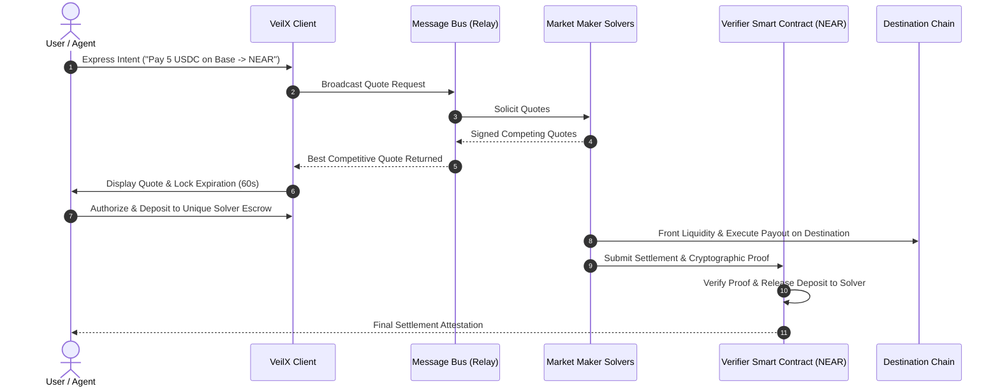

# VEILX AGENT — COMPREHENSIVE NEAR INTENTS CAPABILITY & ARCHITECTURE RESEARCH

> **Research Date:** November 7, 2026  
> **Official Sources:** [https://intents.near.org/](https://intents.near.org/) | [https://docs.near-intents.org/](https://docs.near-intents.org/)  
> **Scope:** Architecture from First Principles, Solvers, Execution Lifecycle, Confidential Intents, Tooling, and AI Agent Applications

---

## 1. NEAR Intents from First Principles

### 1.1 What is an Intent?
In conventional blockchain execution, a user submits an **imperative transaction**—specifying exact contract calls, function parameters, bridge relays, and gas allowances across multiple steps. If any step slips or gas spikes, the transaction reverts or strands funds.

In contrast, an **Intent is a declarative specification of a desired outcome**:
- *Imperative (Conventional):* "Approve USDC on Base, deposit into bridge contract, pay relayer fee, wait for 20 block confirmations, claim wrapped USDC on NEAR, swap on Ref Finance with 1% slippage."
- *Declarative (NEAR Intent):* "I will spend 10 USDC on Base; deliver exactly 2.85 NEAR to `expatq3.near` within 60 seconds, or refund 100% of my deposit."



### 1.2 Architectural Differentiation

| Dimension | Conventional Bridge | DEX Aggregator | NEAR Intents (Defuse Protocol) |
| :--- | :--- | :--- | :--- |
| **Execution Model** | User locks on Chain A; waits for relayer/validator multisig; mints wrapped token on Chain B | User routes swap through multiple AMM liquidity pools; pays slippage on every hop | Off-chain solvers compete to deliver the exact requested asset; solvers front capital |
| **Slippage & MEV** | High bridge slippage; public mempool vulnerability | Vulnerable to sandwich attacks, frontrunning, and liquidity pool imbalances | **Zero Slippage & MEV Immunity**: Quotes are guaranteed off-chain by solver commitments |
| **Speed** | 10 minutes – 2 hours (dependent on finality) | Fast on-chain, but limited to single chain | **Sub-minute cross-chain settlement** (~12–25 seconds) |
| **Failure Mode** | Funds can be trapped in bridge contracts | Transaction reverts, but user still loses gas | **Atomic Refund Guarantee**: If solver fails to deliver, original deposit is refunded |
| **Asset Authenticity**| Often delivers synthetic wrapped tokens (e.g. `wETH`) | Trades native or existing pool tokens | Delivers **native assets** on the target network |

---

## 2. Solvers, Settlement & Verification Lifecycle

### 2.1 The Role of Solvers (Market Makers)
Solvers are professional, high-frequency liquidity providers running automated algorithms connected to the NEAR Intents WebSocket Message Bus. Solvers hold pre-funded liquidity across all 38+ supported blockchains (Bitcoin, Solana, Ethereum, Base, Arbitrum, Dogecoin, etc.). 

When a user broadcasts an intent quote request:
1. Solvers compete in an automated Dutch auction / reverse tender.
2. The winning solver provides a signed cryptographic commitment guaranteeing price, fee, and maximum execution time.
3. The winning solver **fronts their own capital** on the destination chain immediately upon detecting the user's deposit, eliminating wait times for slow cross-chain consensus.

### 2.2 On-Chain Verification & Settlement
Settlement occurs via the **NEAR Intents Verifier Smart Contract**:
- The solver cannot claim the user's deposit on NEAR until they submit cryptographic proof (e.g. SPV proof for Bitcoin, consensus proof for EVM, or verified RPC state) demonstrating that the exact requested asset amount was delivered to the user's specified recipient address.
- **Trust Assumption:** The user does not trust the solver. The protocol is non-custodial and enforces cryptographic atomicity: *No proof of delivery = No release of funds.*

---

## 3. Comprehensive Capabilities Inventory

| Capability Domain | Operational Status | Technical Mechanism | Supported Assets & Chains | VeilX Relevance |
| :--- | :---: | :--- | :--- | :--- |
| **Cross-Chain Swaps** | **Live** | 1Click Swap API & Intents SDK | 38+ chains (BTC, SOL, Base, ETH, NEAR, ARB, DOGE) | Core engine for PayLinks and deposits |
| **Cross-Chain Payments** | **Live** | Direct solver routing to recipient address | Any asset $\rightarrow$ Any native chain payout | Social APay multi-chain tipping |
| **Confidential Intents** | **Beta** | Private Shard + TEE Bridge + PBFT | NEAR, USDC, ETH | Shielded mode and private trading |
| **Chain Abstraction** | **Live** | Unified account derivation + Intent Solver | Universal EVM + Solana + UTXO | Eliminates multiple seed phrases |
| **Agent Skills Integration**| **Live** | LangChain / Eliza / AutoGPT tool wrappers | REST / WebSocket JSON-RPC | Autonomous agent execution tooling |
| **Tokenized Equities Trading**| **Partial / Indirect** | Defuse swaps across NEP-141 wrapped assets | Ondo tokenized equities (`NVDAon`, `TSLAon`) | Stocks Trading execution engine |
| **Token Listing** | **Live** | Permissionless pool registration | Any NEP-141 / ERC-20 / SPL token | Expanding VeilX stock/crypto catalog |
| **Becoming a Solver** | **Live** | Open solver network via Message Bus | Any entity meeting collateral requirements | Future VeilX institutional routing |

---

## 4. Confidential Intents Deep Dive

### 4.1 Architecture of Confidential Intents
Confidential Intents introduces privacy-preserving transaction execution built directly on NEAR's **Private Shard** architecture:

```mermaid
flowchart LR
    subgraph Public Web3 Space
        PublicUser[Public Balance] --> Bridge[TEE Bridge]
        PublicTx[Public Explorer]
    end

    subgraph Confidential Private Shard
        Bridge --> Shielded[Shielded Vault / Balance]
        Shielded --> PrivateExec[Private Intent Execution]
        PrivateExec --> PBFT[Permissioned Validator PBFT Finality (~200ms)]
    end

    PrivateExec --> Bridge
    Bridge --> Settlement[Settled Output]
```

### 4.2 Key Cryptographic Properties:
1. **Private Shard Isolation:** State transitions, amounts, sender addresses, and swap pairs are encrypted and processed by permissioned validators running in confidential hardware environments.
2. **Selective Disclosure:** Users can generate cryptographic zero-knowledge proofs or HMAC attestations to verify payment delivery to a third party (e.g. for tax compliance or commercial invoice auditing) without revealing overall wallet net worth or transaction history.
3. **MEV & Sandwich Attack Protection:** Because pending trades never enter a public mempool, predatory arbitrage bots cannot inspect order flow, frontrun, or sandwich large trades.

### 4.3 Practical Application to VeilX
- **Shielded Social APay:** Hides tip amounts and sender identity when tipping on public platforms like X.
- **Stealth Portfolio Rebalancing:** High-net-worth users can rebalance large equity or crypto positions without telegraphing their moves to public on-chain copy-traders.

---

## 5. Tokenized Equities Reality Check

### Crucial Distinction: What NEAR Intents Can and Cannot Do
- **What NEAR Intents CAN do:** Convert between cryptocurrencies (USDC, NEAR, ETH, SOL) and trade any NEP-141 token deployed on NEAR—including **Ondo-wrapped tokenized equity notes** (`NVDAon`, `TSLAon`, `SPYon`)—provided there is an active liquidity pool or solver willing to quote them.
- **What NEAR Intents CANNOT do:**
  1. NEAR Intents is **not a regulated stock exchange, registered broker-dealer, or SEC transfer agent**.
  2. Holding `TSLAon` does **not** grant DTCC share registration, physical share certificates, corporate voting rights, or direct SEC SIPC insurance.
  3. NEAR Intents does not enforce traditional stock market hours; liquidity and pricing off-market depend entirely on third-party market makers and Ondo's mint/burn facilities.
- **VeilX Responsibility:** VeilX must clearly disclose this distinction in the `/terminal` interface and must not conflate synthetic tokenized exposure with registered equity ownership.
