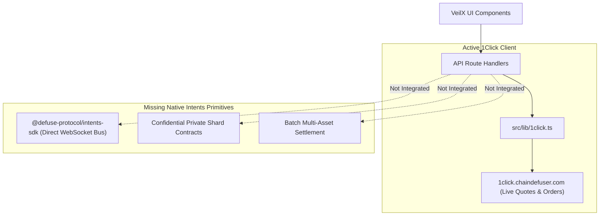
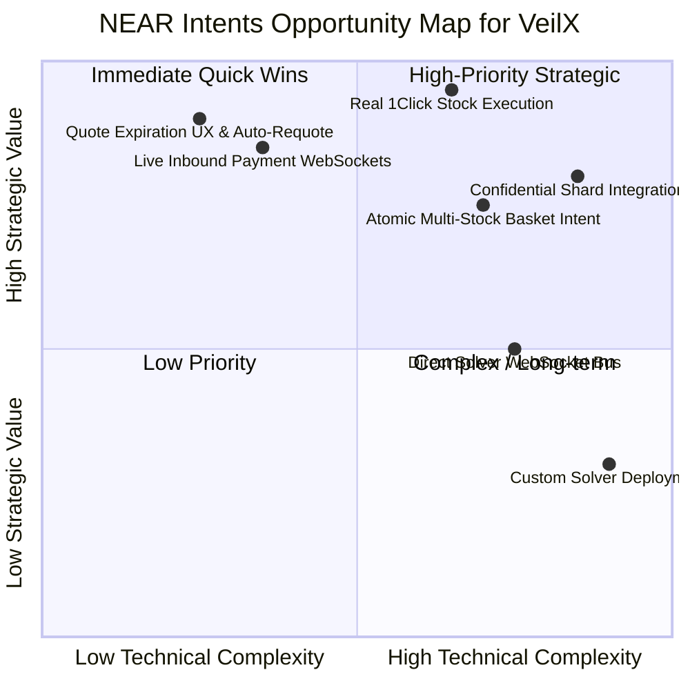

# VEILX AGENT — NEAR INTENTS EXISTING INTEGRATION & GAP ANALYSIS

> **Audit Date:** November 7, 2026  
> **Repository Context:** `C:\Users\HomePC\Downloads\VeilX-Agent`  
> **Focus:** 1Click Swap API, Defuse Protocol, Native Intents SDK, and Practical Product Integration Gaps

---

## 1. What VeilX is Currently Using (Codebase Audit)

The audit reveals that VeilX currently interacts with NEAR Intents primarily through the **Defuse 1Click Swap API** (`https://1click.chaindefuser.com`), implemented in [`src/lib/1click.ts`](file:///C:/Users/HomePC/Downloads/VeilX-Agent/src/lib/1click.ts).

### 1.1 Existing Integration Points

1. **PayLink Omnichain Checkout ([`src/app/pay/[slug]/page.tsx`](file:///C:/Users/HomePC/Downloads/VeilX-Agent/src/app/pay/[slug]/page.tsx)):**
   - *Status:* **Operational on Testnet.**
   - *Mechanism:* Uses `createIntentOrder()` to request an inbound deposit address (e.g., Bitcoin address or Base EVM address). When the payer deposits, solvers route funds to the PayLink creator's NEAR account.
2. **Deposit Modal ([`src/components/modals/DepositModal.tsx`](file:///C:/Users/HomePC/Downloads/VeilX-Agent/src/components/modals/DepositModal.tsx)):**
   - *Status:* **Operational.**
   - *Mechanism:* Solicits cross-chain inbound solver addresses for SOL, BTC, ETH, and USDC.
3. **Chat Conversational Intents ([`src/lib/ai-gateway.ts`](file:///C:/Users/HomePC/Downloads/VeilX-Agent/src/lib/ai-gateway.ts) & [`ChatContainer.tsx`](file:///C:/Users/HomePC/Downloads/VeilX-Agent/src/components/chat/ChatContainer.tsx)):**
   - *Status:* **Partially Implemented.**
   - *Mechanism:* Generates a `cross_chain_intent` action card when the user prompts "Send 10 USDC on Base to @alice". The card triggers `/api/intents`.
4. **Stocks Trading Copilot ([`src/lib/trading-copilot.ts`](file:///C:/Users/HomePC/Downloads/VeilX-Agent/src/lib/trading-copilot.ts)):**
   - *Status:* **Simulated / Mocked.**
   - *Mechanism:* Despite UI claiming "Bought AAPL via Defuse 1Click Solver on NEAR", lines 379–393 generate synthetic hashes. **No live intent order is created for stock trades.**

---

## 2. Capability vs. Implementation Matrix

| NEAR Intents Capability | Existing VeilX Usage | Actual Status in Code | Missing Work Required | Recommendation |
| :--- | :--- | :---: | :--- | :--- |
| **Cross-Chain Inbound Deposits** | Used in `DepositModal.tsx` and `/pay/[slug]` | **Live / Real** | Add live websocket payment listener; display real confirmation blocks | **Keep & Polish** |
| **Cross-Chain Outbound Tipping** | AI Gateway parses prompts; calls `/api/near/send-tip` | **Partial** | Outbound to non-NEAR chains relies on manual solver routing; lacks direct MPC sweep | **Complete Integration** |
| **Tokenized Stocks Order Execution**| Claims 1Click solver execution in chat messages | **Mocked / Simulated** | Wire `createIntentOrder` with Ondo token addresses on NEAR NEP-141; handle liquidity fails | **Mandatory Replacement** |
| **Confidential Intents (Private Shard)**| Mentioned in UI as "Shielded Mode" | **Simulated / HMAC only** | Integrate real NEAR Private Shard TEE bridge contracts; manage shielded balances | **Adopt in Phase 2** |
| **Direct WebSocket Message Bus** | Uses 1Click REST API endpoints only | **Not Implemented** | Integrate `@defuse-protocol/intents-sdk` to listen to live solver quotes directly | **Adopt in Phase 2** |
| **Solver Quote Expiration Handling** | Static text display in PayLinks | **Partial / Flawed** | Real-time countdown timer; auto-requote on expiration without page reload | **Immediate Fix** |
| **Atomic Multi-Asset Basket Intent** | Not used | **Missing** | Execute multi-asset portfolio rebalancing (e.g. buying 4 stocks in 1 atomic intent) | **High-Priority Future** |

---

## 3. Relationship: 1Click API vs. Native NEAR Intents

- **NEAR Intents Protocol:** The base-layer on-chain settlement protocol on NEAR (`intents.near.org`), specifying how intents are signed, verified, and settled atomically by independent market makers.
- **Defuse 1Click API (`1click.chaindefuser.com`):** A developer-friendly, managed REST gateway built by the Defuse core team. It abstracts away the complex WebSocket Message Bus negotiation, manages solver collateral, and provides simple endpoints (`/quote`, `/order`, `/status`).
- **Verdict for VeilX:** Using 1Click API was the correct initial decision for rapid prototyping, but VeilX must not claim to be using native on-chain intents for stocks until it replaces the simulated trading engine with verified 1Click/Defuse execution.

---

## 4. Opportunity Map & Prioritization

### Social APay Roadmap:
1. **Immediate (Phase 1):** Add live countdown timer to `/pay/[slug]` solver quotes; auto-refresh expired quotes seamlessly.
2. **High-Priority (Phase 2):** Connect real-time WebSocket status so PayLink checkouts display instant "Payment Detected" within 2 seconds.
3. **Future (Phase 3):** Confidential Intents for private social tipping.

### Stocks Trading Roadmap:
1. **Immediate (Phase 1):** Eliminate mocked trade hashes; either wire real 1Click swaps for Ondo NEP-141 tokens or explicitly label the experience as **"Simulation / Paper Trading Mode"**.
2. **High-Priority (Phase 2):** Implement atomic multi-asset rebalancing intents to buy/sell entire portfolios in a single atomic solver settlement.
