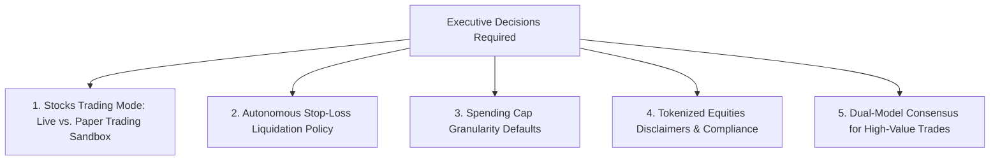

# VEILX AGENT — STRATEGIC DECISIONS & APPROVALS REGISTER

> **Document Date:** November 7, 2026  
> **Status:** Pending User Executive Approval  
> **Purpose:** Documenting key strategic, product, safety, and legal trade-offs that require executive sign-off prior to the next implementation phase.

---

## 1. Decision Register Summary

---

## 2. Detailed Decision Briefs

### Decision 1: Stocks Trading Engine Reality — Live Execution vs. Paper Trading Sandbox
- **Context:** Currently, `src/lib/trading-copilot.ts` and `src/lib/market-analyst.ts` generate simulated trade executions and mock `0x...` transaction hashes. Social APay, however, executes real on-chain transfers on NEAR testnet.
- **Option A (Recommended for Next Phase):** Explicitly label Stocks Trading as **"Paper Trading Sandbox"** in the UI with a toggle to switch to "Live Execution" once Ondo pool liquidity and contract testing are certified.
- **Option B:** Wire live 1Click Defuse swaps immediately for all 28+ Ondo stocks.
- **Trade-off:** Option B risks user financial loss if thin liquidity pools cause high slippage. Option A preserves transparency and user trust while polishing the UX.
- **Status:** **PENDING YOUR APPROVAL.**

---

### Decision 2: Autonomous Stop-Loss Liquidation Policy
- **Context:** The current cron rebalancing script (`market-analyst.ts:122`) automatically liquidates 100% of an equity position into USDC if it drops past the stop-loss threshold (-5% or -10%).
- **Risk:** In crypto/Web3 markets, brief oracle glitches or temporary flash crashes can trigger irreversible liquidations at the exact bottom.
- **Option A (Recommended):** The agent **pauses** buying and alerts the user with an urgent confirmation card: `"[Stop-Loss Breaker Triggered: Liquidate Position? [Yes] [Hold]]"`. Autonomous 100% liquidation is disabled.
- **Option B:** Maintain full autonomous 100% liquidation without human confirmation.
- **Status:** **PENDING YOUR APPROVAL.**

---

### Decision 3: Spending Cap Granularity & Default Limits
- **Context:** Currently, users configure a single flat slider in `SpendingCapModal.tsx` ($50 default).
- **Proposed Enhancement:** Transition to a **3-Tiered Budget System**:
  - *Tier 1: Max Per-Tip Limit* (Default: $15.00)
  - *Tier 2: Daily Outflow Budget* (Default: $50.00)
  - *Tier 3: Weekly Trading Volume Ceiling* (Default: $200.00)
- **Trade-off:** Slightly more complex setup modal vs. vastly superior security against draining attacks.
- **Status:** **PENDING YOUR APPROVAL.**

---

### Decision 4: Regulatory Disclaimers for Ondo Tokenized Equities
- **Context:** Retail users frequently confuse tokenized stock wrappers (e.g. `TSLAon`, `NVDAon`) with actual shares held at a regulated broker (Charles Schwab, Robinhood).
- **Proposed Text in UI:**
  > *"Ondo tokenized equities represent blockchain-wrapped economic notes tracking underlying asset prices. They do not convey shareholder voting rights, DTCC registration, or SIPC brokerage insurance. Trading availability and liquidity are governed by decentralized liquidity pools."*
- **Status:** **PENDING YOUR APPROVAL.**

---

### Decision 5: Multi-Auditor AI Consensus Threshold
- **Context:** Inspired by the *Milestone Vault* and *Chaperone* research posts, high-value operations can require agreement between two distinct AI models (e.g. Gemini 2.5 Flash + Llama 3.3 70B in NEAR AI Cloud TEE).
- **Proposed Threshold:** Any trade or transfer exceeding **$250.00 USD** must achieve dual-model agreement before generating an action card.
- **Status:** **PENDING YOUR APPROVAL.**
