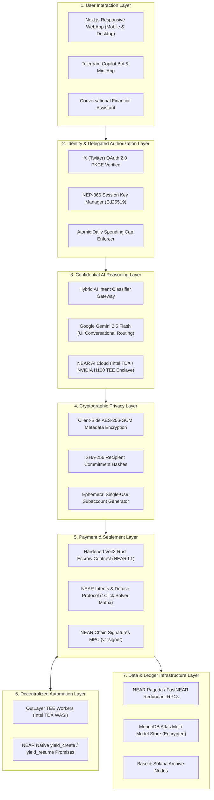
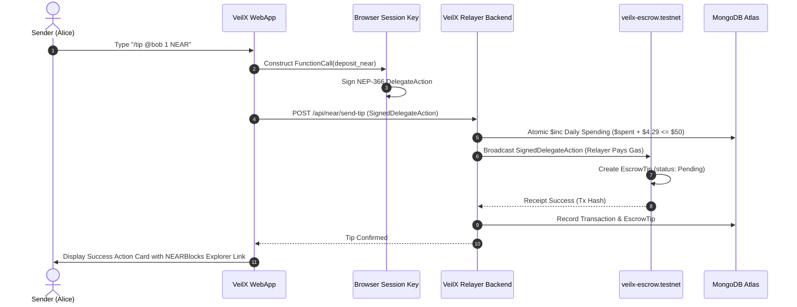
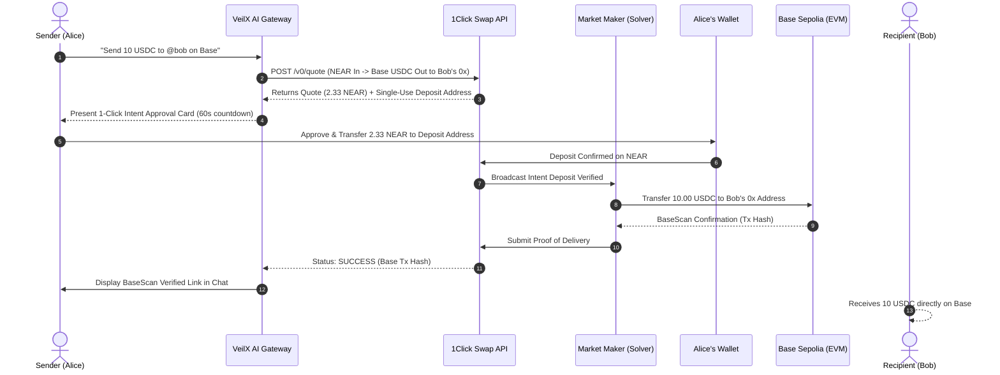
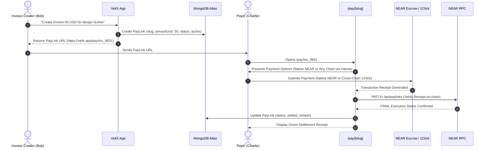
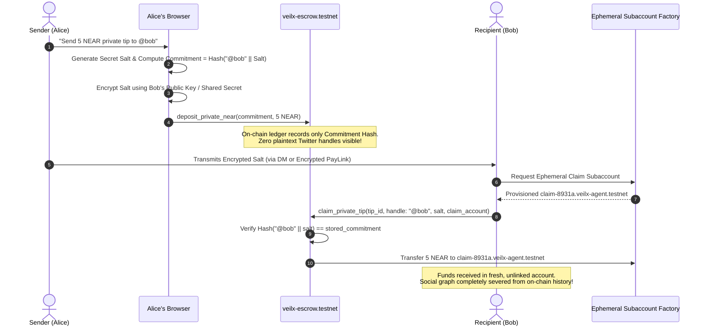
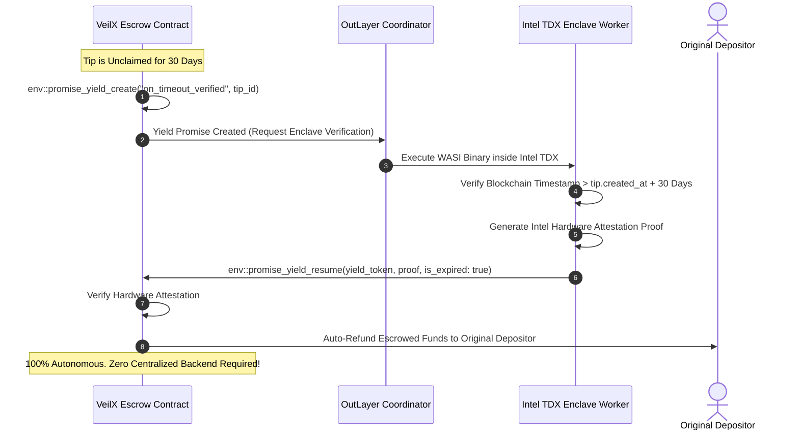

# VEILX AGENT — PROPOSED TARGET SYSTEM ARCHITECTURE & INTEGRATION SPECIFICATION

**Document Version:** 1.0.0  
**Status:** COMPLETE ARCHITECTURAL SPECIFICATION  
**Author:** Senior Full-Stack Protocol Architect & Web3 Security Engineer  
**Date:** November 2026  

---

## 1. COMPREHENSIVE MULTI-LAYER ARCHITECTURE

The proposed target architecture organizes VeilX Agent into seven decoupled, resilient, and non-custodial tiers:

---

## 2. DETAILED LAYER SPECIFICATIONS & BOUNDARIES

### 2.1 Layer 1: User Interaction Layer
* **Progressive Web App (PWA)**: Built on Next.js 14 App Router, optimized across 9 mobile breakpoints (320px–1440px) with responsive header, omnichain portfolio balance drawer, and real-time execution cards.
* **Telegram Copilot**: Integrates deep-linking (`/link`), multi-turn memory via MongoDB `telegram_chats` (24h TTL), and a group-chat privacy shield suppressing confidential financial details in public channels.

### 2.2 Layer 2: Identity & Delegated Authorization Layer
* **Non-Custodial Guarantee**: Private keys are generated client-side in the user's browser. The server and relayer NEVER hold user master keys.
* **Delegated Authority (NEP-366)**: Users sign off-chain `DelegateAction` payloads authorizing specific `FunctionCall` methods (`deposit_near`, `withdraw`) capped by an atomic daily spending limit (default: $50.00/day).

### 2.3 Layer 3: Confidential AI Reasoning Layer
* **Hybrid Routing Engine**:
  * **Gemini 2.5 Flash**: Delivers instant 300ms latency for greetings, help commands, and conversational chit-chat.
  * **NEAR AI Cloud (`api.near.ai`)**: Evaluates all sensitive financial commands (`create_invoice`, `direct_transfer`, `execute_intent`) inside hardware-isolated Intel TDX/NVIDIA H100 TEE enclaves with zero prompt data retention.

### 2.4 Layer 4: Cryptographic Privacy Layer
* **Off-Chain Metadata Encryption**: Invoice descriptions, private notes, and counterparty communications are encrypted client-side using **AES-256-GCM** before reaching the database.
* **On-Chain Commitment Obfuscation**: Escrow smart contract records recipient commitments ($\text{Hash}(\text{handle} \parallel \text{salt})$) instead of raw Twitter usernames.
* **Ephemeral Claim Disbursements**: Payouts route to single-use, unlinked subaccounts or cross-chain destination addresses to sever the public social graph link.

### 2.5 Layer 5: Payment & Settlement Layer
* **Hardened VeilX Escrow**: Rust `near-sdk` 5.30 contract with atomic callbacks (`near_resolve_claim`), relayer override removals, and storage staking DoS protection (`prune_claimed_tip`).
* **NEAR Intents & Defuse (1Click)**: Declarative multi-chain liquidity. Market-making solvers front capital on Base, Arbitrum, Solana, and Ethereum, settled atomically on NEAR.
* **Chain Signatures MPC**: Uses `v1.signer-prod.testnet` to derive foreign addresses and sign cross-chain transactions without bridges.

### 2.6 Layer 6: Decentralized Automation Layer
* **OutLayer TEE Workers**: Decentralized workers running inside Intel TDX hardware enclaves that execute background settlement verification, escrow expiration checks, and automated refunds using NEAR's native asynchronous `yield/resume` promise mechanism.

### 2.7 Layer 7: Data & Ledger Infrastructure Layer
* **Redundant RPCs**: Automated client/server rotation across Pagoda, FastNEAR, and official NEAR testnet nodes.
* **MongoDB Atlas**: High-performance persistence layer with compound indexes on active querying vectors.

---

## 3. SEQUENCE WORKFLOWS

### 3.1 Standard NEAR Social Tip

---

### 3.2 Cross-Chain Tip Using NEAR Intents (Defuse / 1Click)

---

### 3.3 Multi-Chain Invoice Creation & Checkout

---

### 3.4 Proposed Cryptographic Private Payment (Level 2 + 3)

---

### 3.5 Decentralized Automated Workflow with OutLayer

---

## 4. FAILURE MODES & RECOVERY ARCHITECTURE

| Subsystem | Potential Failure Mode | System Impact | Automated Recovery Path |
|---|---|---|---|
| **1Click Intent Solvers** | Solver fails to fulfill within 60s expiration window. | Destination funds not delivered; source deposit locked. | 1Click contract automatically triggers reverse transfer to user's `refundAddress`. StatusRadar displays refund status. |
| **NEAR AI Cloud Gateway** | TEE enclave cold start or network latency spike (>2s). | Financial tool parsing delayed. | Automatic circuit-breaker fallbacks to local deterministic regex engine or Google Gemini with user warning. |
| **NEP-366 Gas Relayer** | Relayer account runs out of gas or server process drops. | Users unable to submit gasless transactions. | Client-side fallback prompts user: *"Relayer subsidy unavailable. Would you like to sign directly using your NEAR wallet?"* |
| **NEAR RPC Outage** | Pagoda testnet node experiences rate limits or preflight failure. | Browser queries fail with CORS/preflight errors. | Server-side proxy ([`/api/near/account`](file:///C:/Users/HomePC/Downloads/VeilX-Agent/src/app/api/near/account/route.ts)) automatically cascades across secondary FastNEAR and primary NEAR testnet endpoints. |
