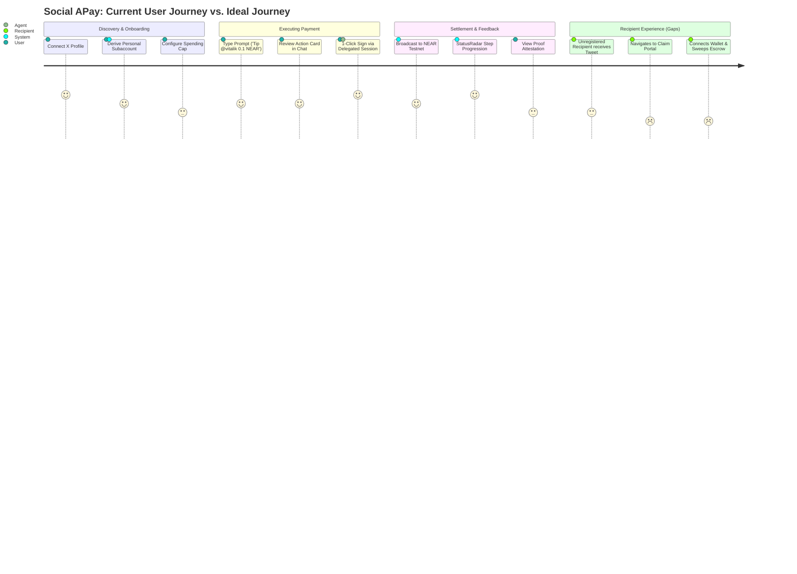
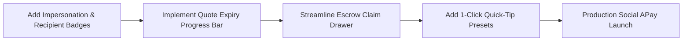

# VEILX AGENT — SOCIAL APAY UX & PRODUCT AUDIT

> **Audit Date:** November 7, 2026  
> **Sub-System:** Social APay (Tipping, Omnichain PayLinks, Payouts, Escrow, Social Commerce)  
> **Repository:** `C:\Users\HomePC\Downloads\VeilX-Agent`  
> **Readiness Score:** **68 / 100**

---

## 1. Executive Summary

Social APay is VeilX's flagship social finance module. It enables non-custodial social tipping to any X/Twitter handle, peer-to-peer transfers across 38+ blockchains, gasless escrow payouts, and universal multichain PayLink checkouts. 

While the core mechanics are operational on NEAR testnet (delegated NEP-366 session keys, 1Click Defuse solver quoting, and PayLink generation), the user journey suffers from fragmented escrow claiming, lack of address/handle validation warnings, and absence of recipient payment preference controls.

---

## 2. In-Depth Component & Journey Evaluation

### 2.1 Onboarding & Identity Presentation
- **Current State:** Handled via [`TwitterClaimModal.tsx`](file:///C:/Users/HomePC/Downloads/VeilX-Agent/src/components/modals/TwitterClaimModal.tsx) and `/api/auth/twitter`. Upon authentication, the system deterministically provisions a non-custodial NEAR account (`{handle}-main.veilx-agent.testnet`).
- **What is Good:** The user never touches raw cryptographic seeds during initial setup. A delegated session key pair is generated locally and stored in browser memory with user-defined spend caps.
- **Defects & Confusion:** If a user logs out and logs in with a different X account, the local cache in `localStorage` can retain stale session keys, requiring a manual localStorage clear.

### 2.2 Payment & Tipping Experience (Chat vs. Modal)
- **Current State:** Users can tip via natural language in `/chat` (e.g. `Tip @expatq3 0.1 NEAR`) or direct wallet transfer modal.
- **Strengths:** 
  - [`MessageBubble.tsx`](file:///C:/Users/HomePC/Downloads/VeilX-Agent/src/components/chat/MessageBubble.tsx#L164-L220) renders a clean confirmation card specifying recipient handle, amount, network, and delegated authority before sending.
  - The [`StatusRadar.tsx`](file:///C:/Users/HomePC/Downloads/VeilX-Agent/src/components/chat/StatusRadar.tsx) component provides clear step-by-step feedback (Spend Cap Check $\rightarrow$ Broadcast $\rightarrow$ Finality).
- **Gaps:** 
  - No batch tipping (e.g., tipping multiple contest winners at once).
  - No default tip presets ($1, $5, $10, $25) in the input bar.
  - Lacks immediate visual warning if an X handle is unverified or newly created (impersonation vector).

### 2.3 Universal Omnichain PayLinks (`/pay/[slug]`)
- **Current State:** Implemented in [`src/app/pay/[slug]/page.tsx`](file:///C:/Users/HomePC/Downloads/VeilX-Agent/src/app/pay/[slug]/page.tsx). Supports payment in NEAR, Base USDC, Arbitrum USDC, Solana SOL, and Bitcoin BTC via Defuse 1Click solver intents.
- **Strengths:** Any internet user can pay an invoice from any supported chain; funds automatically route and settle to the creator's NEAR account.
- **Critical Defects:**
  - **Quote Expiration UX:** Defuse solver quotes expire in 60 seconds. The page displays the expiration in text but lacks a live countdown progress ring. When a quote expires, payment attempts can fail silently without auto-refreshing the quote.
  - **No Dynamic Currency Selection by Payer:** The payer cannot easily adjust the tip/overpay amount for gratuity.

### 2.4 Gasless Escrow Claiming
- **Current State:** Unregistered users who receive tips have funds deposited into a gasless smart-contract escrow on `veilx-agent.testnet`.
- **Gaps & Friction:**
  - When the recipient signs in, the UI notifies them of pending tips, but claiming requires multiple clicks and doesn't allow forwarding directly to an external EVM address (e.g. MetaMask on Base) in one step.

---

## 3. Systematic Breakdown: 9 Audit Questions

| Audit Dimension | Evaluation & Findings |
| :--- | :--- |
| **1. What is already good?** | Delegated session key authority (NEP-366); PayLink cross-chain settlement; StatusRadar step progression; clean neutral typography. |
| **2. What is incomplete?** | Gasless escrow forwarding to external chains; selective disclosure proof verification details; multi-recipient tipping. |
| **3. What is confusing?** | Distinguishing between "Direct On-Chain Transfer" and "Social Escrow Tip" in conversational prompts; solver quote expiry behavior. |
| **4. What is unnecessarily complicated?** | Requiring users to open a separate modal to view private receipts instead of an inline expandable drawer in chat. |
| **5. What is missing?** | Impersonation detection badge (handle age/follower count); auto-refreshing quote timer on `/pay/[slug]`; tipping presets ($1, $5, $10). |
| **6. What should be redesigned?** | The Escrow Claim banner in HeaderNav: currently a text indicator; should be an actionable drawer showing pending inbound tips with 1-click claim-all. |
| **7. What should be removed?** | Redundant "Share on X" buttons on transactions that are not social tips (e.g. self-transfers or internal swaps). |
| **8. What should be simplified?** | The destination address derivation display: collapse technical MPC derivation strings behind an expandable "Advanced Network Routing" toggle. |
| **9. Required before Production?** | Live WebSocket transaction status updates; handle collision safeguards; quote expiration auto-recovery. |

---

## 4. UI/UX Remediation Roadmap for Social APay

