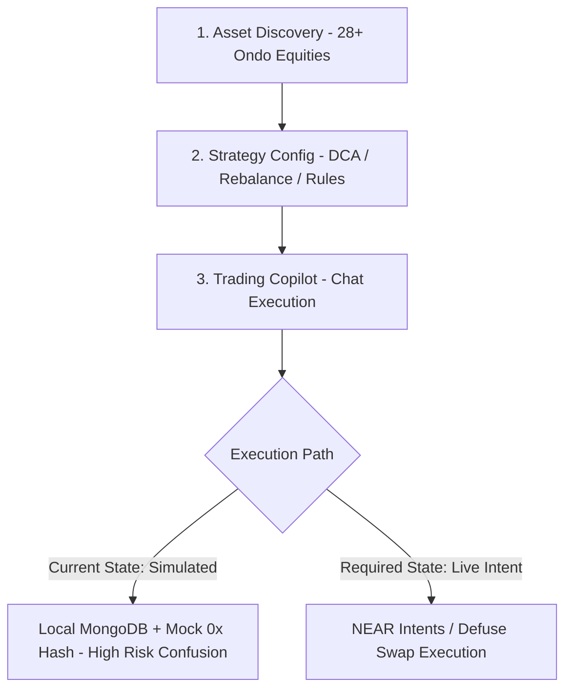
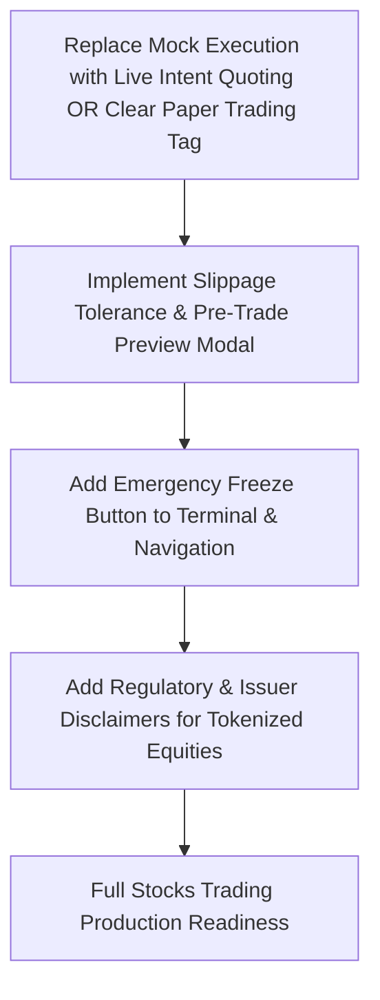

# VEILX AGENT — STOCKS TRADING UX & INVESTMENT READINESS AUDIT

> **Audit Date:** November 7, 2026  
> **Sub-System:** Stocks Trading (Ondo Tokenized Equities, ETF Catalogs, DCA Automation, Autonomous Rebalancing)  
> **Repository:** `C:\Users\HomePC\Downloads\VeilX-Agent`  
> **Readiness Score:** **54 / 100**

---

## 1. Executive Summary

VeilX's Stocks Trading engine aims to give users exposure to 28+ US equities and ETFs (NVIDIA, Tesla, Apple, S&P 500, Gold, Silver, Treasuries) on NEAR via Ondo tokenized equities. It features automated Dollar-Cost Averaging (DCA), mathematical rebalancing (RSI-14 momentum + volatility filters), and a conversational Trading Copilot.

However, the investment experience currently has the lowest verified readiness score (**54%**) across the platform. While the front-end components render smoothly, the trading engine operates as a **simulated sandbox in browser memory and MongoDB**, rather than executing live order fills on-chain. Furthermore, critical institutional investor safeguards—such as trading hours disclosures, slippage guards, and corporate action warnings—are absent.



---

## 2. In-Depth Component & Journey Evaluation

### 2.1 Asset Discovery & Information Architecture
- **Current State:** Handled in [`src/components/modals/StockCatalogModal.tsx`](file:///C:/Users/HomePC/Downloads/VeilX-Agent/src/components/modals/StockCatalogModal.tsx) and [`src/lib/ondo-stocks.ts`](file:///C:/Users/HomePC/Downloads/VeilX-Agent/src/lib/ondo-stocks.ts).
- **What is Good:**
  - Fast client-side search across 28+ assets.
  - High-fidelity vector logos for all tickers (`QQQon`, `GLDon`, `SLVon`, `TLTon`, `AGGon`, `NVDAon`, `TSLAon`).
  - Seamless "Add to Watchlist" action updating local portfolio state.
- **Defects & Misleading UX:**
  - **Asset Nature Disclosure:** The interface does not explicitly explain that these tokens are **Ondo-wrapped tokenized notes**, not direct brokerage shares registered with the SEC or DTCC. Users are not informed about custody, redemption mechanisms, or bankruptcy remoteness of the issuer.
  - **Market Hours vs. 24/7 Web3 Trading:** Traditional US equities trade 9:30 AM – 4:00 PM EST. The UI allows users to place orders 24/7 without warning about off-market liquidity discounts, wider spreads, or weekend price freezing.

### 2.2 Order Preview, Slippage & Execution Lifecycle
- **Current State:** Implemented in [`src/app/terminal/page.tsx`](file:///C:/Users/HomePC/Downloads/VeilX-Agent/src/app/terminal/page.tsx) and [`src/lib/trading-copilot.ts`](file:///C:/Users/HomePC/Downloads/VeilX-Agent/src/lib/trading-copilot.ts).
- **Critical Defects:**
  - **Mock Hash Generation:** Lines 379–393 of `trading-copilot.ts`:
    ```typescript
    const mockTxHash = "0x" + Array.from({ length: 40 }, () => Math.floor(Math.random() * 16).toString(16)).join("");
    ```
    Instant buy and sell orders generate random hexadecimal strings that mimic transaction hashes. The user is told "Bought AAPL via Defuse 1Click Solver on NEAR", but no transaction actually touches the blockchain.
  - **Missing Slippage Control:** There is no slippage tolerance input (e.g. 0.5%, 1%, 2%). If a real trade were executed on a thin pool, the user could experience massive price impact without consent.
  - **No Pre-Trade Cost Breakdown:** The order preview shows the total price, but omits:
    1. Solver execution fee.
    2. NEAR gas fee.
    3. Price deviation vs. traditional NASDAQ/NYSE live spot feed.

### 2.3 Automated DCA & Rebalancing Engine
- **Current State:** Evaluated via [`src/lib/market-analyst.ts`](file:///C:/Users/HomePC/Downloads/VeilX-Agent/src/lib/market-analyst.ts) and [`/api/agent/cron-rebalance`](file:///C:/Users/HomePC/Downloads/VeilX-Agent/src/app/api/agent/cron-rebalance).
- **Strengths:** Mathematical rules evaluate RSI-14 momentum, stop-loss (-5%), and take-profit (+10%) conditions systematically.
- **Security & Authorization Flaws:**
  - **Autonomous Capital Reallocation Without Cooldown:** In [`market-analyst.ts:122-145`](file:///C:/Users/HomePC/Downloads/VeilX-Agent/src/lib/market-analyst.ts#L122-L145), when a stop-loss is reached, the engine automatically liquidates 100% of the position into USDC. If market prices experience a temporary oracle flash-crash, the agent would irreversibly liquidate user equity holdings with zero human confirmation.
  - **No Global Emergency Pause:** While individual rules can be cancelled in the Terminal tab, there is no high-visibility "PAUSE ALL AUTONOMOUS TRADING" toggle that immediately halts all cron rebalancing.

---

## 3. Systematic Breakdown: 9 Audit Questions

| Audit Dimension | Evaluation & Findings |
| :--- | :--- |
| **1. What is already good?** | Watchlist management; stock logo rendering; clean technical indicator calculations (RSI-14, SMA-20); percentage-based dip/target triggers. |
| **2. What is incomplete?** | Real on-chain settlement integration; historical portfolio performance graphs (only mock charts currently render); live order book/depth chart. |
| **3. What is confusing?** | Simulated execution presenting as live blockchain trades; ticker symbols ending in "on" without explanation of the Ondo wrapper. |
| **4. What is unnecessarily complicated?** | Dual rule configuration interfaces (conversational copilot vs. manual parameter form on Terminal page). |
| **5. What is missing?** | Slippage tolerance configuration; market hours disclaimer; issuer risk documentation; emergency portfolio freeze button. |
| **6. What should be redesigned?** | The Terminal order placement flow: must include explicit confirmation modal showing minimum received, max slippage, fee, and real solver quote. |
| **7. What should be removed?** | The deceptive generation of synthetic `0x...` transaction hashes. If in test/simulation mode, it must explicitly say "[Simulated Paper Trade]". |
| **8. What should be simplified?** | The risk guardrail wizard: consolidate technical options into 3 clear investor risk tiers (Conservative, Balanced, Dynamic). |
| **9. Required before Production?** | Live settlement execution through NEAR Intents / Defuse; mandatory stop-loss confirmation overrides; oracle staleness breaker. |

---

## 4. UI/UX Remediation Roadmap for Stocks Trading


