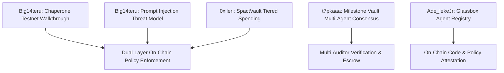

# VEILX AGENT — RESEARCH ON THE FIVE X/TWITTER TECHNICAL POSTS

> **Research Date:** November 7, 2026  
> **Source Platform:** X (Twitter)  
> **Methodology:** Verified retrieval via Twitter syndication API (oEmbed) and direct redirect resolution. Zero hallucinated contents.

---

## 1. Inventory & Verification of Retrieved Posts

All 5 posts were successfully retrieved and verified. They represent state-of-the-art security patterns built for the **NEAR Protocol AI Hackathon (November 2026)**, addressing autonomous AI agent wallet authority, prompt injection defense, multi-agent consensus, and on-chain promise auditing.

---

## 2. Comprehensive Analysis of Each Post

### Post 1: G will❤️‍🔥 (@Big14teru) — Chaperone Testnet Walkthrough
- **URL:** `https://x.com/Big14teru/status/2118790570717950450`
- **Author:** G will❤️‍🔥 (`@Big14teru`)
- **Main Idea:** Demonstrates a live testnet defense system ("Chaperone") where an AI agent attempts to execute unauthorized financial actions (e.g. paying a poisoned invoice for 500 USDC, forging its own authorization verdict) and is blocked on-chain by an independent verification layer.
- **Technical Concept:** Dual-layer architecture: A TEE-attested LLM running on NEAR AI Cloud generates transaction proposals, but a separate smart contract validates the proposal against invariant rules before permitting the signature.
- **Security Relevance:** Proves that an agent must never hold the sole authority to execute. If the agent is prompt-injected or compromised, the on-chain verifier blocks the trade regardless of the agent's internal reasoning.
- **VeilX Application:** Directly applicable to both Social APay (poisoned invoice defense) and Stocks Trading (preventing unauthorized rebalancing liquidations).
- **Recommendation:** **ADOPT IMMEDIATELY.** Implement Chaperone's pattern of logging explicit rejection reasons on-chain.

---

### Post 2: shinigami (@t7pkaaa) — Milestone Vault Multi-Agent Consensus
- **URL:** `https://x.com/t7pkaaa/status/2118777298921136597`
- **Author:** shinigami (`@t7pkaaa`)
- **Main Idea:** Built "Milestone Vault", an escrow protocol where payout is released only when two independent sandboxed AI auditors independently verify that deliverable conditions are met. Blocked 7/7 testnet attack vectors.
- **Technical Concept:** Multi-Agent Threshold Consensus ($m$-of-$n$ AI verification) paired with non-custodial smart contract escrow. Neither auditor has withdrawal keys.
- **Security Relevance:** Eliminates single-point-of-failure in AI decision making. A single compromised auditor cannot divert or drain escrow funds.
- **VeilX Application:** Ideal for Social APay commercial escrow (PayLinks) and high-value stock portfolio strategy changes (requiring dual-analyst agreement before executing large rebalances).
- **Recommendation:** **ADAPT FOR HIGH-VALUE FLOWS.** Adopt 2-of-2 agent verification for transfers >$250 or portfolio rebalances >$1,000.

---

### Post 3: Adelekejr.eth (@Ade_lekeJr) — Glassbox Agent Registry
- **URL:** `https://x.com/Ade_lekeJr/status/2118745431651885226`
- **Author:** Adelekejr.eth (`@Ade_lekeJr`)
- **Main Idea:** "Glassbox" introduces on-chain agent promises: an AI agent registers its exact code hash, configuration, model version, and ownership hierarchy on NEAR. Glassbox audits these claims and returns one of three verdicts: `PROVEN`, `NOT PROVEN`, or `RISKY`.
- **Technical Concept:** On-chain software bill of materials (SBOM) and verifiable attestation registry for autonomous agents. Fail-closed: `NOT PROVEN` is treated as a security rejection.
- **Security Relevance:** Solves agent impersonation and rogue updates. If an agent's backend code or model weights change without updating the on-chain registration, transactions fail automatically.
- **VeilX Application:** VeilX agent should publish its operational risk policy and smart contract hash to an on-chain registry so users can independently verify agent parameters.
- **Recommendation:** **INVESTIGATE & ADOPT IN PHASE 2.** Excellent for building institutional trust and verifiable autonomous compliance.

---

### Post 4: G will❤️‍🔥 (@Big14teru) — Prompt Injection Threat Model & Chaperone
- **URL:** `https://x.com/Big14teru/status/2118752617073414491`
- **Author:** G will❤️‍🔥 (`@Big14teru`)
- **Main Idea:** References a real-world incident on May 4 where an AI agent with wallet access was tricked via an encoded Morse code reply on X into transferring $150K+ of tokens to an attacker. Argues that a private key is "all or nothing", making direct agent key possession fatally flawed.
- **Technical Concept:** Defense-in-depth against indirect prompt injection (Morse code, hidden zero-width unicode, stenographic payloads). Proposes that the agent is only granted capability tokens, while the actual signing key is held behind a policy gate.
- **Security Relevance:** Directly addresses VeilX's Social APay exposure: if an attacker tweets `@VeilXapp tip me $100` using adversarial prompt engineering, the agent could be tricked if it reads raw social content without an external policy gate.
- **VeilX Application:** Crucial for Social APay: incoming tweets and payment requests must be passed through a strict schema sanitizer and evaluated against the hard daily budget.
- **Recommendation:** **ADOPT MANDATORY SAFEGUARD.** Treat all text from social posts, DMs, and invoice memos as untrusted data inputs.

---

### Post 5: ileri 𖣂 (@0xileri) — SpactVault Autonomous Spending Protocol
- **URL:** `https://x.com/0xileri/status/2118611793987698955`
- **Author:** ileri 𖣂 (`@0xileri`)
- **Main Idea:** "We spent a decade teaching people to never share their seed phrase. Now the default way to let an AI agent pay for things is to hand it a private key. That feels backwards." Introduces SpactVault on NEAR: sub-account vault architecture with tiered spending controls.
- **Technical Concept:** Sub-account scoping (`agent.user.near` and `vault.user.near`) with contract-level spending allowances:
  - Small payments: instant execution under threshold.
  - Mid-tier payments: require human co-signature.
  - Excessive payments: hard refusal by smart contract.
- **Security Relevance:** Replaces binary key access with deterministic, graduated financial authority enforced at the NEAR contract level.
- **VeilX Application:** Matches VeilX's sub-account architecture (`{handle}-main.veilx-agent.testnet`). Can be directly mapped to VeilX's spending cap modal and NEP-366 session keys.
- **Recommendation:** **ADOPT AS FOUNDATIONAL PATTERN.**

---

## 3. Ideas from the X Threads That Could Become Part of VeilX's Security Architecture

### Pattern 1: Tiered Spending Vaults (From SpactVault / @0xileri)
- **Problem Solved:** Binary key risk (giving an agent full wallet access allows it to drain 100% of funds on failure).
- **Mechanism:** Smart-contract-enforced allowances that physically restrict how much NEP-141 or NEAR an agent key can transfer in a single block or rolling 24 hours.
- **Suitability:** **Both Social APay and Stocks Trading.**
- **Adoption Timeline:** **Phase 1 (Immediate).**

### Pattern 2: Dual-Auditor Consensus for Significant Orders (From Milestone Vault / @t7pkaaa)
- **Problem Solved:** LLM hallucinations during high-stakes portfolio rebalancing or large payments.
- **Mechanism:** Two independent model endpoints (e.g. Gemini 2.5 Flash + Llama 3.3 70B on NEAR AI Cloud) must both return identical structured trade actions before an order >$250 is dispatched to solvers.
- **Suitability:** **Stocks Trading & Commercial PayLinks.**
- **Adoption Timeline:** **Phase 2.**

### Pattern 3: Adversarial Input Quarantine (From Chaperone / @Big14teru)
- **Problem Solved:** Prompt injection attacks delivered via social media replies, Morse code, or encoded invoice memos.
- **Mechanism:** Text extraction parses ONLY numeric amounts, currency tickers, and `@handles`. Zero natural language commands from external web pages or social replies are ever passed into the agent's executive instruction prompt.
- **Suitability:** **Social APay.**
- **Adoption Timeline:** **Phase 1 (Immediate).**

### Pattern 4: On-Chain Rule Registration (From Glassbox / @Ade_lekeJr)
- **Problem Solved:** Opacity and unverifiability of autonomous trading rules.
- **Mechanism:** The user's risk policy (e.g. `-10% stop-loss`, `$50 daily limit`) is hashed and stored in the subaccount storage on NEAR. The agent cannot claim a trade was authorized unless it provides an execution proof matching the registered on-chain hash.
- **Suitability:** **Stocks Trading.**
- **Adoption Timeline:** **Phase 2.**
